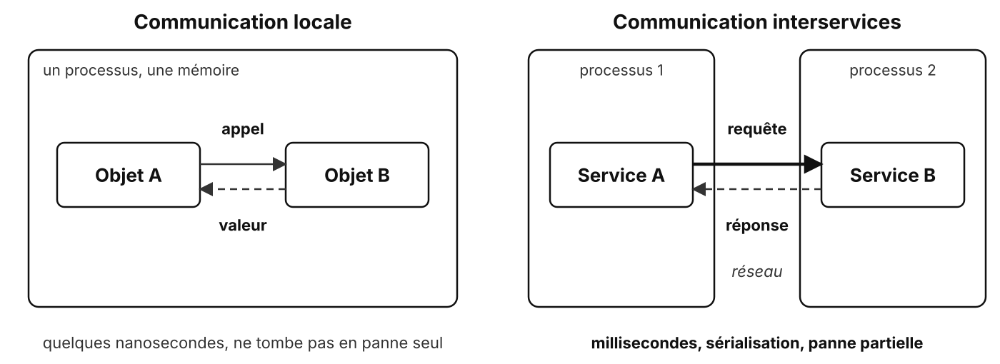
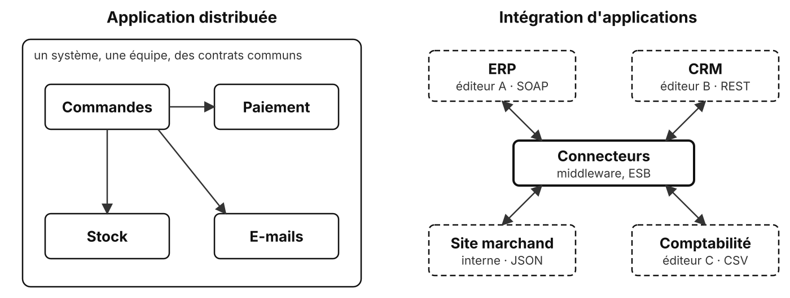
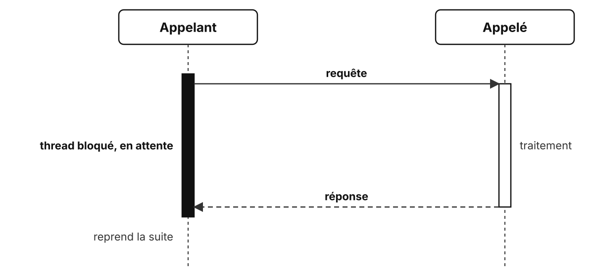
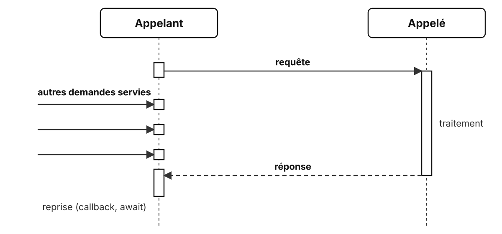
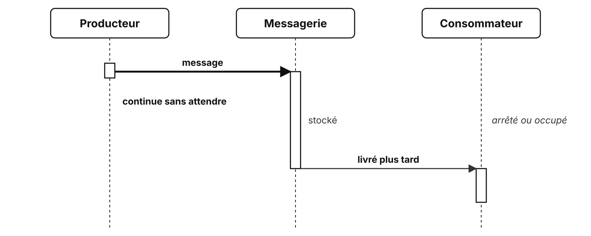

# Modèles de communication

Qui parle à qui, et comment

<!-- Apport du formateur à l'étape 4 de l'atelier : les notions sont posées après que les groupes les ont fait émerger. -->

---

## Local ou interservices

<!-- Un appel de méthode réussit ou lève une exception ; un appel réseau peut aussi ne jamais revenir. -->

---

## Ce que le réseau change

- **Latence** : des millisecondes au lieu de nanosecondes, cumulées à chaque appel en chaîne
- **Panne partielle** : l'autre service peut être arrêté, lent, ou injoignable
- **Sérialisation** : les données voyagent dans un format commun (JSON, Protobuf...)
- **Versions** : chaque service évolue et se déploie à son rythme
- **Sécurité** : chaque échange passe par un réseau qu'il faut protéger

---

## Les huit sophismes du distribué

| On suppose que... | En réalité |
| --- | --- |
| le réseau est fiable | des paquets se perdent, des connexions tombent |
| la latence est nulle | chaque appel coûte, surtout en chaîne |
| la bande passante est infinie | les gros messages ralentissent tout |
| le réseau est sûr | il faut chiffrer et authentifier |
| la topologie ne change pas | les services bougent, redémarrent, se multiplient |
| il n'y a qu'un administrateur | plusieurs équipes, plusieurs règles |
| le transport ne coûte rien | sérialisation, CPU, facture du cloud |
| le réseau est homogène | langages, OS et protocoles différents |

<!-- Les « sophismes de l'informatique distribuée » (fallacies of distributed computing) : liste de L. Peter Deutsch et James Gosling (Sun, années 1990). Chaque modèle de communication répond à une partie de ces problèmes. -->

---

## Application distribuée ou intégration

<!--
Application distribuée : on choisit les formats et les protocoles.

Intégration d'applications d'entreprise (EAI) : on subit les formats et les protocoles des applications existantes, d'où les connecteurs, adaptateurs et bus (ESB).
-->

---

## Trois catégories

| Catégorie | L'appelant... | Exemple |
| --- | --- | --- |
| **Synchrone bloquant** | attend, sa ressource est immobilisée | un thread par requête qui appelle une API de paiement |
| **Synchrone non bloquant** | attend, sa ressource sert d'autres demandes | `await fetch(...)` dans Node.js |
| **Asynchrone** | n'attend pas, le message sera traité plus tard | un e-mail de confirmation mis en file |

---

## Synchrone bloquant

Simple à écrire, mais un thread immobilisé par appel en cours

<!-- 200 appels lents en parallèle : 200 threads qui attendent. La limite du serveur est vite atteinte. -->

---

## Synchrone non bloquant

Toujours besoin de la réponse, mais personne n'attend les bras croisés

<!-- Boucle d'événements (Node.js), programmation réactive (Reactor, RxJS) : peu de threads pour beaucoup d'appels en cours. -->

---

## Asynchrone

Producteur et consommateur n'ont pas besoin d'être là en même temps

<!-- Découplage temporel : le consommateur peut être arrêté au moment de l'envoi. En contrepartie, pas de réponse immédiate, et il faut gérer les messages en échec. -->

---

## Synchrone, bloquant : deux questions

| Axe | La question |
| --- | --- |
| **Synchrone ou asynchrone** | L'appelant a-t-il besoin de la réponse pour continuer ? |
| **Bloquant ou non bloquant** | Que fait sa ressource pendant l'attente ? |

Le premier se décide à la **conception**, le second à l'**implémentation**

---

## D'autres façons de classer

| Axe | Valeurs |
| --- | --- |
| Destinataires | **point à point** ou **diffusion** |
| Forme | **requête-réponse** ou **flux** continu |
| Sens | **unidirectionnel** ou **bidirectionnel** |
| Initiative | le client **tire** ou le serveur **pousse** |

---

## Les critères de choix

| Critère | La question |
| --- | --- |
| **Couplage** | Faut-il connaître l'autre, son adresse, son format, sa disponibilité ? |
| **Performance** | Quelle latence, quel débit, combien d'appels en cours ? |
| **Fiabilité** | Que se passe-t-il si l'autre tombe ? |
| **Interopérabilité** | Quels langages, un navigateur peut-il l'utiliser ? |
| **Sécurité** | Quelle surface exposée, comment authentifier ? |

<!-- Ce sont des caractéristiques architecturales (exigences non fonctionnelles) : elles servent de grille pour chaque modèle du module. -->

---

## Quatre questions par flux

| Question | Ce qu'elle révèle |
| --- | --- |
| Qui parle à qui ? | point à point ou diffusion |
| Faut-il une réponse immédiate ? | synchrone ou asynchrone |
| Et si le destinataire est indisponible ? | fiabilité, découplage temporel |
| Quel volume, à quelle fréquence ? | performance, flux, back-pressure |

---

## Le panorama du module

| Technologie | Catégorie | Forme |
| --- | --- | --- |
| REST | synchrone | requête-réponse |
| Flux réactif, SSE | synchrone non bloquant | flux, le serveur pousse |
| gRPC | synchrone | requête-réponse ou flux, bidirectionnel |
| WebSocket | connexion permanente | flux bidirectionnel |
| Webhook | le serveur rappelle | requête-réponse inversée |
| Queue | asynchrone | point à point |
| Publish/subscribe | asynchrone | diffusion |

<!-- Pas de meilleur modèle : un système réel en combine plusieurs, chacun là où il répond au besoin. -->

---

## À retenir

- Un appel réseau peut être **lent**, **perdu** ou **sans réponse**
- **Synchrone** : on a besoin de la réponse ; **bloquant** : on immobilise une ressource pour l'attendre
- **Asynchrone** : l'émetteur et le récepteur n'ont pas besoin d'être là en même temps
- Le choix se fait **flux par flux**, selon le couplage, la performance, la fiabilité, l'interopérabilité et la sécurité

---

## Des questions ?

---

## Sources

- [Fallacies of distributed computing (Wikipedia)](https://en.wikipedia.org/wiki/Fallacies_of_distributed_computing)
- Gregor Hohpe, Bobby Woolf, [Enterprise Integration Patterns](https://www.enterpriseintegrationpatterns.com/)
- Microsoft, [Communication in a microservice architecture](https://learn.microsoft.com/en-us/dotnet/architecture/microservices/architect-microservice-container-applications/communication-in-microservice-architecture)
