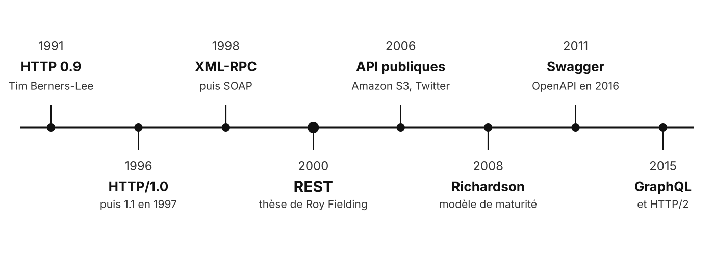
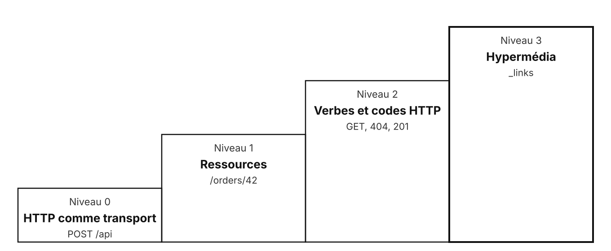

# REST

Representational State Transfer

<!--
Trois parties, à trois moments du jour 1 :
- REST, SOAP, GraphQL (10h30) ;
- Fastify (13h30) ;
- HATEOAS et versions d'API (15h30, avant le TP 2).
-->

---

## Historique



<!--
REST n'a pas été inventé pour les API : Fielding décrit après coup ce qui a fait le succès du Web, dont il a coécrit HTTP/1.1.

Point sur les connaissances, à main levée, la suite s'adapte aux réponses :
- quel verbe pour créer une ressource ? `POST` (ou `PUT` si le client choisit l'URI) ;
- quelle différence entre `PUT` et `PATCH` ? `PUT` remplace la ressource entière, `PATCH` en modifie une partie ;
- quel code pour une ressource absente ? `404 Not Found` ;
- que veut dire « sans état » ? le serveur ne garde rien de la conversation entre deux requêtes, chaque requête porte tout ce qu'il faut (dont le jeton d'authentification).
-->

---

## Les principes de REST

- **Client-serveur** : l'interface et les données évoluent séparément
- **Sans état** : chaque requête porte tout ce qu'il faut
- **Cache** : une réponse dit si elle peut être réutilisée
- **Interface uniforme** : des ressources, des représentations, des verbes
- **Système en couches** : proxy, cache, passerelle, invisibles pour le client

**Sur HTTP** : tout le protocole sert, pas un simple tuyau

<!-- Contraintes définies par Roy Fielding dans sa thèse (2000). Une sixième, facultative : le code à la demande (le serveur envoie du code à exécuter).

REST ne dépend pas de HTTP : la dernière ligne est la façon de l'appliquer sur HTTP. L'URI désigne la ressource, le verbe dit l'action, le code dit le résultat, les en-têtes portent le format, le cache, l'authentification. C'est le niveau 2 de Richardson, et ce que SOAP ne fait pas (`POST` partout). -->

---

## Les méthodes

| Méthode | Usage | Sûre | Idempotente |
| --- | --- | --- | --- |
| `GET` | lire | oui | oui |
| `POST` | créer, déclencher une action | non | non |
| `PUT` | remplacer | non | oui |
| `PATCH` | modifier en partie | non | non |
| `DELETE` | supprimer | non | oui |

<!--
Sûre : ne modifie rien côté serveur. Idempotente : la rejouer donne le même état final, on peut donc la relancer sans risque après une coupure réseau.

PATCH peut être rendue idempotente, mais rien ne le garantit.
-->

---

## Les codes de statut

<div class="text-[34px]">

| Famille | Sens | Les plus courants |
| --- | --- | --- |
| `2xx` | succès | `200 OK`, `201 Created`, `204 No Content` |
| `3xx` | redirection | `301 Moved Permanently`, `304 Not Modified` |
| `4xx` | erreur du client | `400`, `401`, `403`, `404`, `409`, `422` |
| `5xx` | erreur du serveur | `500`, `502`, `503`, `504` |

</div>

<!--
401 : pas authentifié ; 403 : authentifié mais pas autorisé ; 409 : conflit avec l'état de la ressource ; 422 : données bien formées mais invalides.

502 Bad Gateway, 503 Service Unavailable, 504 Gateway Timeout : erreurs typiques d'un appel entre services (le service appelé ne répond pas, ou mal).
-->

---

## Les en-têtes utiles

| En-tête | Rôle |
| --- | --- |
| `Content-Type` | format du corps envoyé |
| `Accept` | format attendu en réponse |
| `Authorization` | qui fait la demande |
| `Location` | adresse de la ressource créée |
| `ETag` | version de la ressource, pour le cache |
| `Cache-Control` | durée et conditions de mise en cache |

---

## Un échange HTTP

<div class="grid grid-cols-2 gap-10">
<div>

```http
GET /orders/42 HTTP/1.1
Host: shop.example
Accept: application/json
Authorization: Bearer eyJhbGci...
```

</div>
<div>

```http
HTTP/1.1 200 OK
Content-Type: application/json
ETag: "a1b2c3"

{ "id": 42, "status": "PAID" }
```

</div>
</div>

Ligne de requête ou de statut, en-têtes, ligne vide, corps

---

## Le modèle de maturité de Richardson



La plupart des API s'arrêtent au niveau 2

---

## Du niveau 0 au niveau 2

<div class="text-[32px]">

| Niveau | Lire la commande 42 | Commande absente |
| --- | --- | --- |
| 0 | `POST /api`, l'action dans le corps | `200`, l'erreur dans le corps |
| 1 | `POST /orders/42` | `200`, l'erreur dans le corps |
| 2 | `GET /orders/42` | `404 Not Found` |

</div>

<!-- Au niveau 2, un proxy, un cache ou un outil de supervision comprend l'échange sans connaître l'API. -->

---

## Un format d'erreur commun

```json
{
  "type": "https://shop.example/problems/out-of-stock",
  "title": "Article en rupture de stock",
  "status": 409,
  "detail": "Il reste 0 exemplaire de l'article 17",
  "instance": "/orders/42"
}
```

`Content-Type: application/problem+json` (RFC 9457)

<!-- Le client traite toutes les erreurs de la même façon, quelle que soit l'API. -->

---

## REST et SOAP

<div class="text-[30px]">

| Critère | REST | SOAP |
| --- | --- | --- |
| Nature | style d'architecture | protocole |
| Format | libre, JSON surtout | XML, dans une enveloppe |
| Contrat | facultatif (OpenAPI) | obligatoire (WSDL) |
| Transport | HTTP | HTTP, SMTP, JMS... |
| Méthodes HTTP | porteuses de sens | `POST` partout (niveau 0) |
| Normes associées | peu | WS-Security, transactions... |
| Usage actuel | API web, services internes | banque, assurance, administration |

</div>

---

## Un message SOAP

```xml
<soap:Envelope xmlns:soap="http://www.w3.org/2003/05/soap-envelope">
  <soap:Header/>
  <soap:Body>
    <GetOrder xmlns="http://shop.example/orders">
      <OrderId>42</OrderId>
    </GetOrder>
  </soap:Body>
</soap:Envelope>
```

L'action est dans le corps, pas dans le verbe ni l'URI

<!-- SOAP reste courant en intégration d'applications d'entreprise : savoir le reconnaître et le consommer (client généré à partir du WSDL). -->

---

## Forces et limites de REST

<div class="grid grid-cols-2 gap-10">
<div>

**Forces**

- simple, lisible
- tout langage parle HTTP
- cache HTTP
- outillage abondant

</div>
<div>

**Limites**

- l'appelé doit être disponible
- latence des appels en chaîne
- pas de flux continu
- trop ou pas assez de données

</div>
</div>

<!--
À montrer après le débat.

Sécurité : HTTPS, authentification par jeton, une surface exposée par endpoint.
-->

---

## GraphQL

<div class="text-[32px]">

| Critère | REST | GraphQL |
| --- | --- | --- |
| Points d'entrée | un par ressource | un seul : `POST /graphql` |
| Données renvoyées | fixées par le serveur | choisies par le client |
| Contrat | facultatif | schéma typé obligatoire |
| Temps réel | non | souscriptions |
| Cache HTTP | natif | perdu |
| Limites | plusieurs appels par écran | requêtes coûteuses, problème N+1 |

</div>

<!-- Hors fiche module, mais courant : savoir le positionner face à REST. -->

---

## Même besoin, deux API

Les 3 premiers dépôts d'un utilisateur GitHub et leurs 2 derniers tickets

<div class="grid grid-cols-2 gap-10">
<div>

```http
GET /users/octocat/repos
GET /repos/octocat/repo-1/issues
GET /repos/octocat/repo-2/issues
GET /repos/octocat/repo-3/issues
```

REST : 4 appels, des champs en trop

</div>
<div>

```graphql
{
  user(login: "octocat") {
    repositories(first: 3) {
      nodes {
        name
        issues(last: 2) { nodes { title } }
      }
    }
  }
}
```

GraphQL : 1 appel, les champs voulus

</div>
</div>

<!-- GitHub expose les deux : API REST v3 et API GraphQL v4. L'explorateur GraphQL de GitHub permet de lancer la requête en direct. -->

---

## Fastify

---

## Pourquoi Fastify

- Framework HTTP **léger** pour Node.js
- **Non bloquant** par construction : une boucle d'événements
- **Validation** des requêtes et des réponses par schéma JSON
- Gestion des erreurs **centralisée**
- Proche du HTTP brut : la communication reste **visible**

<!-- Express est plus répandu, mais sans validation intégrée ; NestJS ajoute une couche d'architecture qui cache la communication. -->

---

## Une route

```js {all|3|4-5|6}
const app = Fastify({ logger: true });

app.get('/orders/:id', async (request, reply) => {
  const order = orders.get(request.params.id);
  if (!order) return reply.code(404).send({ error: 'commande inconnue' });
  return order;
});

await app.listen({ port: 3000, host: '0.0.0.0' });
```

Le handler renvoie une valeur : Fastify la sérialise en JSON

<!-- Piège : oublier le `return` devant `reply.code(...).send(...)`, le handler continue et tente d'envoyer une seconde réponse. -->

---

## Valider par schéma

```js {2-8|10-11}
app.post('/orders', {
  schema: {
    body: {
      type: 'object',
      required: ['item', 'quantity'],
      properties: { item: { type: 'string' }, quantity: { type: 'integer', minimum: 1 } },
    },
  },
}, async (request, reply) => {
  const order = createOrder(request.body);
  return reply.code(201).header('Location', `/orders/${order.id}`).send(order);
});
```

Corps invalide : `400` automatique, le handler n'est pas appelé

---

## HATEOAS et versions d'API

---

## HATEOAS

```json
{
  "id": 42,
  "status": "PENDING",
  "_links": {
    "self": { "href": "/orders/42" },
    "pay": { "href": "/orders/42/payment", "method": "POST" },
    "cancel": { "href": "/orders/42", "method": "DELETE" }
  }
}
```

La réponse dit **ce qu'on peut faire** : le client suit les liens

<!--
Une commande payée n'a plus de lien `pay` : la règle métier reste côté serveur, le client affiche les boutons selon les liens présents.

Format HAL : `_links` (avec `self`) et `_embedded` pour les ressources incluses.
-->

---

## Où mettre la version ?

<div class="text-[32px]">

| Où | Exemple | Pour | Contre |
| --- | --- | --- | --- |
| URI | `/v2/orders/42` | visible, simple à router | une ressource, plusieurs URI |
| En-tête `Accept` | `vnd.shop.v2+json` | URI stable | invisible, plus dur à tester |
| Paramètre | `?version=2` | simple | se perd facilement, cache moins efficace |

</div>

<!-- En-tête complet : `Accept: application/vnd.shop.v2+json` (type de média propre au fournisseur).

Le plus répandu : la version dans l'URI. Une version majeure seulement quand un changement casse les clients existants ; ajouter un champ ne casse rien. -->

---

## Retirer une ancienne version

```http
HTTP/1.1 200 OK
Deprecation: @1767225600
Sunset: Thu, 31 Dec 2026 23:59:59 GMT
Link: <https://shop.example/docs/v2>; rel="successor-version"
```

- `Deprecation` : la version est dépréciée depuis cette date
- `Sunset` : elle cessera de répondre à cette date
- `Link` : où trouver la suivante

<!-- RFC 9745 (Deprecation) et RFC 8594 (Sunset). Les deux versions tournent côte à côte le temps que les clients migrent. -->

---

## À retenir

- **Niveau 2** de Richardson : ressources, verbes et codes HTTP respectés
- Un **format d'erreur** commun : `application/problem+json`
- **SOAP** : encore présent en intégration d'applications d'entreprise
- **GraphQL** : le client choisit ses données, au prix du cache HTTP
- **HATEOAS** : la réponse porte les actions possibles
- **Versions** : les faire cohabiter, puis annoncer le retrait

---

## Des questions ?

---

## Sources

- Roy Fielding, [Architectural Styles and the Design of Network-based Software Architectures](https://ics.uci.edu/~fielding/pubs/dissertation/top.htm), 2000
- Martin Fowler, [Richardson Maturity Model](https://martinfowler.com/articles/richardsonMaturityModel.html)
- [RFC 9110, sémantique HTTP](https://www.rfc-editor.org/rfc/rfc9110) · [RFC 9457, Problem Details](https://www.rfc-editor.org/rfc/rfc9457) · [RFC 9745, Deprecation](https://www.rfc-editor.org/rfc/rfc9745) · [RFC 8594, Sunset](https://www.rfc-editor.org/rfc/rfc8594)
- [HAL (draft IETF)](https://datatracker.ietf.org/doc/html/draft-kelly-json-hal) · [GraphQL](https://graphql.org/learn/) · [API GraphQL de GitHub](https://docs.github.com/fr/graphql)
- [Fastify](https://fastify.dev/docs/latest/)
