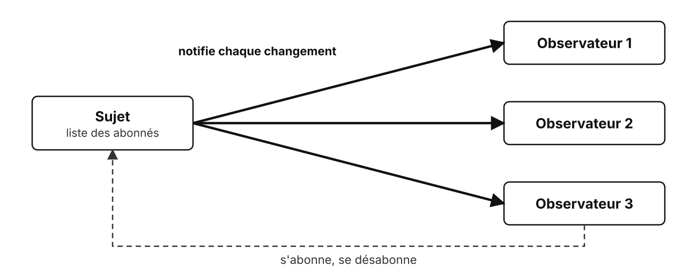
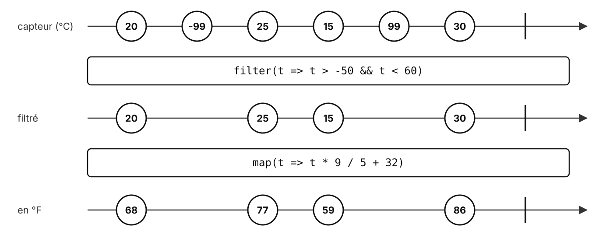
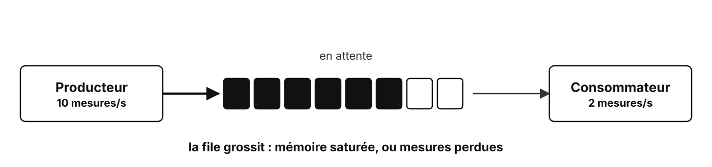
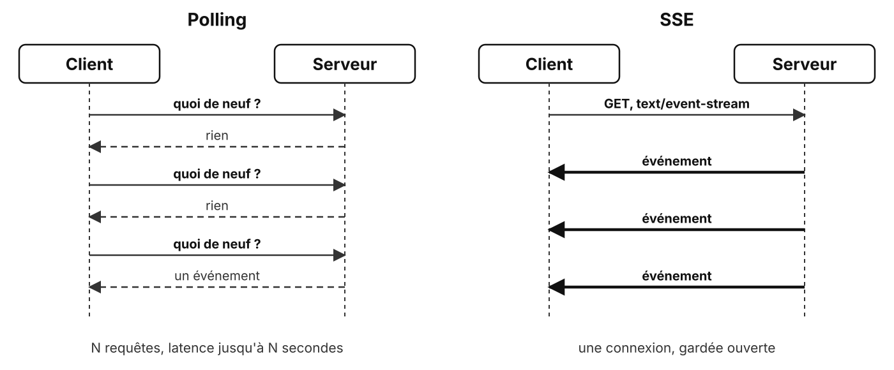

# Programmation réactive

Des flux plutôt que des appels

<!--
Deux parties :
- programmation réactive (jour 1, 16h15) ;
- un flux sur HTTP avec SSE (jour 2, ouverture du TP 3).
-->

---

## Le pattern Observer



Le sujet ne connaît pas ses observateurs, il les prévient

<!-- Rappel : déjà vu en conception objet (écouteurs d'événements, data binding). La programmation réactive généralise l'idée. -->

---

## Une valeur ou plusieurs

| | Une valeur | Plusieurs valeurs |
| --- | --- | --- |
| **Tout de suite** | une fonction | un tableau, un itérable |
| **Plus tard** | une `Promise` | un **flux** (observable, générateur asynchrone) |

Un flux émet des valeurs dans le temps, puis **se termine** ou **échoue**

---

## Un flux et ses opérateurs



<!-- Diagramme en billes (marble diagram) : la documentation de RxJS présente chaque opérateur de cette façon. La barre verticale marque la fin du flux. -->

---

## Déclarer, puis s'abonner

```js {all|3-7|9-12}
import { interval, map, filter, take } from 'rxjs';

const temperatures$ = interval(500).pipe(
  map(() => readSensor()),
  filter((t) => t > -50 && t < 60),
  take(10),
);

temperatures$.subscribe({
  next: (t) => console.log(`${t} °C`),
  complete: () => console.log('fin du flux'),
});
```

Sans `subscribe`, **rien ne se passe** : le flux est paresseux

<!-- Le `$` final est une convention de nommage pour les flux, pas une syntaxe. -->

---

## Les opérateurs courants

| Opérateur | Effet |
| --- | --- |
| `map` | transforme chaque valeur |
| `filter` | garde certaines valeurs |
| `bufferCount(n)` | regroupe par paquets de `n` |
| `debounceTime(ms)` | attend un silence avant d'émettre |
| `sampleTime(ms)` | garde une valeur par période |
| `merge` | fusionne plusieurs flux |

<!-- `debounceTime` : la recherche qui part quand l'utilisateur arrête de taper. `sampleTime` : un affichage rafraîchi une fois par seconde, quel que soit le débit du capteur. -->

---

## Impératif ou déclaratif

<div class="grid grid-cols-2 gap-10">
<div>

**Objet, impératif**

- on **appelle** des méthodes
- on **modifie** un état
- on décrit **les étapes**

</div>
<div>

**Réactif, déclaratif**

- on **s'abonne** à un flux
- les données **circulent**
- on décrit **la transformation**

</div>
</div>

Les deux se combinent : des objets qui communiquent par flux

---

## Back-pressure



Que faire quand le producteur va **plus vite** que le consommateur ?

<!-- Entre services : sans back-pressure, un service lent sature la mémoire de celui qui l'alimente, ou tombe. -->

---

## Push ou pull

<div class="text-[32px]">

| Modèle | Qui décide | Consommateur lent | Exemples |
| --- | --- | --- | --- |
| **Push** | producteur | tampon, ou perte | RxJS, événements |
| **Pull** | consommateur | le producteur attend | streams Node.js, `for await` |

</div>

<!-- Reactive Streams (Java, Reactor) : le consommateur annonce combien il peut traiter avec `request(n)`, un pull par lots. -->

---

## Le pull en JavaScript

```js {1-5|7-9}
async function* readTemperatures() {
  while (true) {
    yield await readSensor();
  }
}

for await (const t of readTemperatures()) {
  await save(t);
}
```

La mesure suivante n'est lue qu'après `save` : **rien ne s'accumule**

<!--
`yield` livre une valeur et suspend le générateur jusqu'à la demande suivante.

Le problème se déplace sans disparaître : un vrai capteur qui mesure sans cesse devra garder ou jeter les mesures pendant l'attente.
-->

---

## Le manifeste réactif

| Propriété | Le système... |
| --- | --- |
| **Disponible** | répond dans des délais constants |
| **Résilient** | reste disponible en cas de panne |
| **Souple** | s'adapte à la charge |
| **Orienté messages** | communique par messages asynchrones |

<!-- Reactive Manifesto (2014) : la même idée à l'échelle d'une architecture. La messagerie du jour 3 en est l'outil principal. -->

---

## Un flux sur HTTP : SSE

---

## Polling ou SSE



<!-- SSE : Server-Sent Events. Du HTTP ordinaire, que les proxys et pare-feux laissent passer. -->

---

## Le format `text/event-stream`

```http
HTTP/1.1 200 OK
Content-Type: text/event-stream
Cache-Control: no-cache

retry: 2000

id: 1
data: {"celsius": 20.5}

id: 2
event: alert
data: {"celsius": 41.0}
```

Du texte : un champ par ligne, une **ligne vide** termine l'événement

<!-- `retry` : délai de reconnexion en millisecondes. `id` : renvoyé par le navigateur dans `Last-Event-ID` à la reconnexion. `event` : type d'événement, `message` par défaut. -->

---

## Côté navigateur

```js
const source = new EventSource('/temperatures');

source.onmessage = (e) => show(JSON.parse(e.data));
source.addEventListener('alert', (e) => warn(JSON.parse(e.data)));
source.onerror = () => setStatus('reconnexion...');
```

- **Reconnexion automatique**, avec `Last-Event-ID`
- `source.close()` pour arrêter

---

## Côté serveur

```js {1|3|4-6}
res.writeHead(200, { 'Content-Type': 'text/event-stream', 'Cache-Control': 'no-cache' });

for await (const t of readTemperatures()) {
  if (!res.write(`data: ${JSON.stringify(t)}\n\n`)) {
    await once(res, 'drain');
  }
}
```

`write` renvoie `false` : le tampon est plein, on attend `drain`

<!--
La back-pressure de bout en bout : un client lent ralentit la lecture des mesures au lieu de remplir la mémoire du serveur.

Arrêter la boucle quand le client se déconnecte (événement `close` de la requête).
-->

---

## Limites de SSE

- **Un seul sens** : du serveur vers le client
- **Du texte** seulement, du JSON en pratique
- En HTTP/1.1, **6 connexions** au plus par domaine et par navigateur
- Certains proxys **retiennent** la réponse au lieu de la transmettre

<!-- HTTP/2 lève la limite des 6 connexions (multiplexage). Pour les deux sens : WebSocket, vu plus tard. -->

---

## À retenir

- Un **flux** émet des valeurs dans le temps ; il est **paresseux**
- Les **opérateurs** décrivent la transformation, pas les étapes
- **Back-pressure** : stocker ou perdre en push, ralentir le producteur en pull
- **SSE** : le serveur pousse sur une connexion HTTP ouverte

---

## Des questions ?

---

## Sources

- [RxJS](https://rxjs.dev/guide/overview) · [Reactive Streams](https://www.reactive-streams.org/) · [Manifeste réactif](https://www.reactivemanifesto.org/fr)
- [Générateurs asynchrones et for await (MDN)](https://developer.mozilla.org/fr/docs/Web/JavaScript/Reference/Statements/for-await...of)
- [Server-sent events (MDN)](https://developer.mozilla.org/fr/docs/Web/API/Server-sent_events/Using_server-sent_events) · [Spécification HTML, server-sent events](https://html.spec.whatwg.org/multipage/server-sent-events.html)
- [Back-pressure dans les streams Node.js](https://nodejs.org/en/learn/modules/backpressuring-in-streams)
