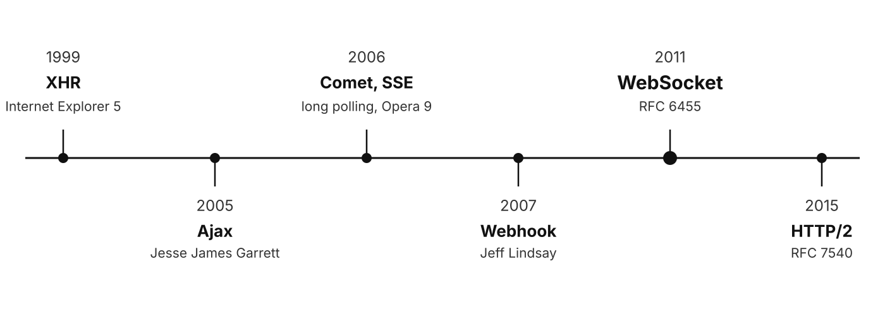
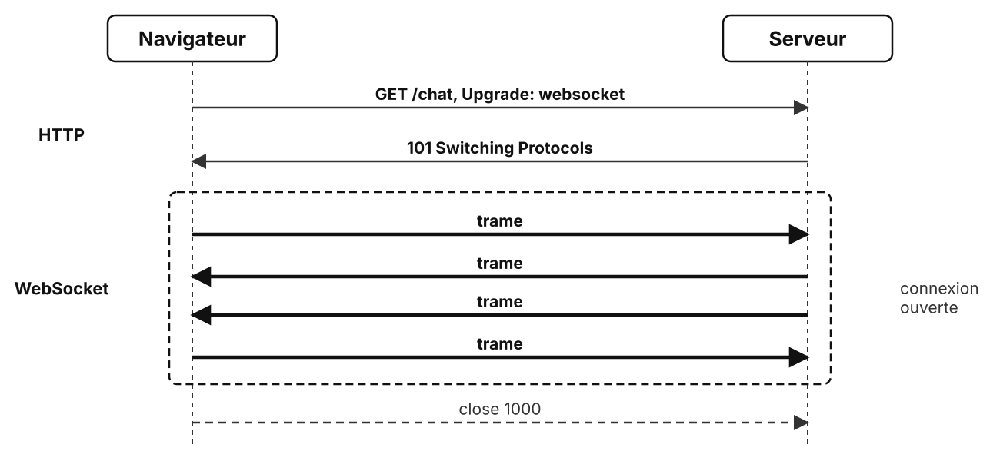
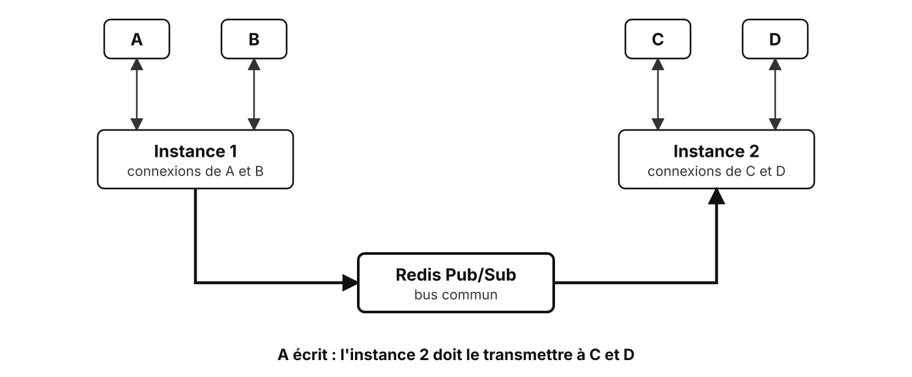

# Temps réel

SSE, WebSocket et webhook

---

## Historique



<!--
HTTP est fait pour que le client demande : pousser une information a longtemps demandé des contournements.

- 1999 : XMLHttpRequest (XHR) arrive avec Internet Explorer 5 : une page peut interroger le serveur sans se recharger.
- 2005 : Jesse James Garrett nomme Ajax ; le polling se généralise.
- 2006 : Alex Russell nomme Comet (long polling, streaming HTTP) ; Opera 9 propose les Server-Sent Events.
- 2007 : Jeff Lindsay nomme les webhooks : un rappel HTTP entre serveurs.
- 2011 : WebSocket, RFC 6455, une vraie connexion dans les deux sens.
- 2015 : HTTP/2 multiplexe les flux, ce qui lève la limite de connexions de SSE.
-->

---

## Trois façons de pousser

<div class="text-[30px]">

| Critère | SSE | WebSocket | Webhook |
| --- | --- | --- | --- |
| Sens | serveur vers client | les deux | serveur vers serveur |
| Connexion | HTTP gardée ouverte | dédiée, après HTTP | une requête par événement |
| État | maintenu | maintenu | sans état |
| Format | texte | texte ou binaire | libre, JSON en pratique |
| Exemple | cours de bourse | chat, jeu en ligne | paiement accepté |

</div>

<!-- SSE a été vu avec la programmation réactive : on le compare ici aux deux autres. -->

---

## WebSocket : la poignée de main



<!-- Le début est du HTTP : les pare-feux le laissent passer. Ensuite, la connexion TCP sert à un autre protocole, fait de trames. -->

---

## La montée en protocole

```http {1-5|7-9}
GET /chat HTTP/1.1
Upgrade: websocket
Connection: Upgrade
Sec-WebSocket-Key: dGhlIHNhbXBsZSBub25jZQ==
Sec-WebSocket-Version: 13

HTTP/1.1 101 Switching Protocols
Upgrade: websocket
Sec-WebSocket-Accept: s3pPLMBiTxaQ9kYGzzhZRbK+xOo=
```

`Sec-WebSocket-Accept` prouve que le serveur parle **vraiment** WebSocket

<!-- La réponse est le hachage SHA-1 de la clé suivie d'une constante fixée par la RFC, encodé en base64 : l'exemple vient de la RFC 6455. Ce n'est pas une sécurité : wss:// (TLS) chiffre la connexion. -->

---

## Côté navigateur

```js
const socket = new WebSocket('wss://example.com/chat');

socket.onopen = () => socket.send(JSON.stringify({ text: 'bonjour' }));
socket.onmessage = (e) => show(JSON.parse(e.data));
socket.onclose = (e) => console.log('fermée', e.code);
```

- **Pas de reconnexion automatique**, contrairement à `EventSource`
- Le format des messages est à **inventer** : JSON en pratique

<!-- La même API existe dans Node.js depuis la version 22, pour écrire un client. -->

---

## Côté serveur avec `ws`

```js {all|3|5-6|7-11}
import { WebSocketServer, WebSocket } from 'ws';

const wss = new WebSocketServer({ port: 8080 });

wss.on('connection', (socket) => {
  socket.on('message', (data) => {
    for (const client of wss.clients) {
      if (client !== socket && client.readyState === WebSocket.OPEN) {
        client.send(data.toString());
      }
    }
  });
});
```

Le serveur **tient la liste** des connexions ouvertes

<!-- `data` est un Buffer : `toString()` renvoie une trame texte, sinon le navigateur reçoit un Blob. -->

---

## Fermer une connexion

<div class="text-[30px]">

| Code | Sens |
| --- | --- |
| `1000` | fermeture normale |
| `1001` | départ : page fermée, serveur arrêté |
| `1006` | coupure sans fermeture propre (jamais envoyé) |
| `1008` | message refusé par la politique du serveur |
| `1011` | erreur interne du serveur |

</div>

La **reconnexion** est à écrire côté client, avec un délai croissant

<!-- 1006 est constaté par le client quand la connexion tombe (réseau, serveur planté) : aucune trame de fermeture n'est arrivée. -->

---

## Une communication avec état

- Chaque connexion ouverte **occupe de la mémoire** côté serveur
- Un répartiteur de charge doit garder un client sur **la même instance**
- Une connexion qui se ferme : **nettoyer** ce qui la concernait
- Un redémarrage coupe **tous** les clients d'un coup

<!-- C'est la différence majeure avec REST : une requête REST peut aller sur n'importe quelle instance. -->

---

## Plusieurs instances



<!-- Redis Pub/Sub (ou Valkey, son fork libre) : publication sans stockage, l'instance absente perd le message. Le publish/subscribe revient au jour 3 avec RabbitMQ. -->

---

## Webhook


Un appel HTTP **inversé** : c'est le fournisseur qui appelle

<!-- Cas typique d'intégration entre deux systèmes indépendants : paiement en ligne, dépôt Git qui déclenche une intégration continue, messagerie d'équipe. -->

---

## Signer un webhook

```js {1-3|5-9}
// Fournisseur : signe le corps avec un secret partagé
const signature = createHmac('sha256', SECRET).update(body).digest('hex');
await fetch(url, { method: 'POST', headers: { 'X-Signature': `sha256=${signature}` }, body });

// Récepteur : recalcule et compare en temps constant
const expected = Buffer.from(`sha256=${createHmac('sha256', SECRET).update(rawBody).digest('hex')}`);
const received = Buffer.from(req.headers['x-signature'] ?? '');
const valid = received.length === expected.length && timingSafeEqual(received, expected);
if (!valid) return reply.code(401).send();
```

Sans signature, **n'importe qui** peut appeler l'URL

<!-- Signer le corps brut, avant toute analyse JSON : un JSON réécrit ne donne pas la même signature. `timingSafeEqual` évite de deviner la signature octet par octet au temps de réponse. -->

---

## Recevoir un webhook

- Vérifier la **signature**, puis répondre **vite** (`2xx`)
- Traiter **ensuite**, de façon asynchrone
- Le même événement peut arriver **deux fois** : idempotence par son `id`
- L'ordre d'arrivée n'est **pas garanti**

<!-- Le fournisseur réessaie tant qu'il n'a pas de 2xx : un traitement long provoque des doublons. Garder les id déjà traités suffit à ignorer un doublon. -->

---

## Lequel choisir ?

<div class="text-[30px]">

| Besoin | Choix |
| --- | --- |
| Le serveur informe un navigateur | **SSE** |
| Navigateur et serveur échangent dans les deux sens | **WebSocket** |
| Un système prévient un autre système, indépendant | **Webhook** |
| Des flux entre services internes | **gRPC** ou **messagerie** |

</div>

---

## À retenir

- **SSE** : un sens, du HTTP simple, reconnexion automatique
- **WebSocket** : deux sens, une connexion **avec état** à gérer
- **Webhook** : un POST signé par événement, à recevoir **idempotent**
- Plusieurs instances : un **bus commun** pour diffuser

---

## Des questions ?

---

## Sources

- [WebSocket (MDN)](https://developer.mozilla.org/fr/docs/Web/API/WebSockets_API) · [RFC 6455](https://www.rfc-editor.org/rfc/rfc6455) · [ws](https://github.com/websockets/ws)
- [Server-sent events (MDN)](https://developer.mozilla.org/fr/docs/Web/API/Server-sent_events) · [Comet (Wikipedia)](https://en.wikipedia.org/wiki/Comet_(programming))
- [Webhook (Wikipedia)](https://en.wikipedia.org/wiki/Webhook) · [HMAC dans Node.js](https://nodejs.org/api/crypto.html#class-hmac)
- [Redis Pub/Sub](https://redis.io/docs/latest/develop/interact/pubsub/)
