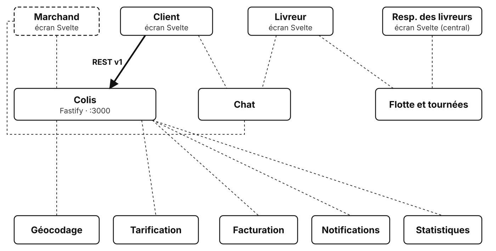

# TP1 : Suivi de colis v1

## Contexte

> **De :** Anne Onyme, support client · **Objet :** « Où est mon colis ? »
>
> Bonjour,
>
> Hier, j'ai répondu 73 fois à la même question au téléphone. 73. J'ai compté.
>
> Mona m'a dit que vous alliez exposer le suivi des colis dans une API, et que les écrans du site pourraient s'en servir. Je veux bien croire aux miracles.
>
> Une demande : quand un client se trompe de numéro, qu'il ait un message clair, pas une page blanche.
>
> Anne

Le service colis existe : un serveur **Fastify** (JavaScript) qui démarre, avec une dizaine de colis d'exemple en mémoire. Il ne sait encore que lister les colis. Vous en faites une API REST de **niveau 2** du modèle de Richardson : des ressources, les bons verbes, les bons codes HTTP, et des erreurs toujours au même format.

## Objectif

Exposer le suivi des colis en REST : routes, verbes et codes HTTP respectés, erreurs gérées en un seul endroit.



En gras : ce que ce TP ajoute au système. En pointillés : ce qui reste à construire.

## Prérequis

- Séquences « REST : rappels et positionnement » et « Présentation de Fastify et du projet de départ » ;
- Docker, VS Code et Bruno (voir le [README des TP](../README.md)).

## Ce qui est fourni

```text
01-depart/
  docker-compose.yml   service colis (port 3000) et écrans web (port 5173)
  src/server.js        démarrage du serveur
  src/app.js           création de l'application : étape 5
  src/v1.js            les routes de l'API v1 et leurs schémas de validation : étapes 1 à 4, c'est ici que vous travaillez
  src/parcel.js        statuts d'un colis et transitions autorisées (canTransition)
  src/data.js          colis d'exemple, findParcel(), nextId()
  src/problem.js       sendProblem() : envoie une erreur au format unique de l'API
  test/v1.test.js      tests automatiques (1 sur 12 passe au départ)
  bruno/               collection Bruno : 2 requêtes, à compléter
```

Le format d'erreur, envoyé par `sendProblem(reply, status, title, detail)` :

```json
{ "type": "about:blank", "title": "Colis introuvable", "status": 404, "detail": "Aucun colis CLB-9999" }
```

Les écrans web, lancés avec le service colis par `docker compose up`, sont accessibles sur [http://localhost:5173](http://localhost:5173). Un menu en haut de page permet de passer d'un écran à l'autre :

| Écran | Adresse | Au TP1 | Ce qui le fait fonctionner |
| --- | --- | --- | --- |
| **Client** | [http://localhost:5173/#/client](http://localhost:5173/#/client) | ✅ utilisable, en version `v1` (la `v2` arrive au TP2) | étape 1 (un colis par son numéro) |
| **Central** | [http://localhost:5173/#/central](http://localhost:5173/#/central) | ✅ utilisable | liste fournie, boutons de statut à l'étape 3, filtre à l'étape 4 |
| **Livreur** | [http://localhost:5173/#/livreur](http://localhost:5173/#/livreur) | 🚧 « Écran en préparation » | TP5 |
| **Marchand** | [http://localhost:5173/#/marchand](http://localhost:5173/#/marchand) | 🚧 visible, mais le calcul du prix échoue (`404`) | TP7 (service de tarification) |

Au départ, l'écran **Client** affiche une erreur `404` : la route `GET /v1/parcels/:id` n'existe pas encore. C'est le premier signe de progrès à guetter.

Statuts et transitions d'un colis :

```text
READY ──► IN_TRANSIT ──► DELIVERED
```

## Travail demandé

### Mise en route

1. Dans `01-depart/`, lancer `docker compose up`. Le premier démarrage installe les dépendances (une minute environ).
2. Ouvrir [http://localhost:3000/v1/parcels](http://localhost:3000/v1/parcels) : l'API renvoie la liste des colis en JSON.
3. Ouvrir l'écran **Central**, [http://localhost:5173/#/central](http://localhost:5173/#/central) : la même liste s'affiche dans un tableau.
4. Ouvrir la collection `bruno/` dans Bruno, choisir l'environnement `local`, lancer « Lister les colis ».

### Étape 1 : un colis par son numéro

`GET /v1/parcels/:id` renvoie le colis, ou `404` au format problème s'il n'existe pas. L'écran **Client** fonctionne dès cette étape.

<details>
<summary>💡 Comment répondre 404 ?</summary>

Le `:id` de l'URL est un paramètre de chemin : Fastify le range dans `request.params.id`.

`findParcel(id)` renvoie le colis, ou `undefined` s'il n'existe pas.

```text
chercher le colis avec le numéro de l'URL
si absent : renvoyer l'erreur 404, et s'arrêter là
sinon : renvoyer le colis
```

<details>
<summary>📖 Que lire dans la documentation ?</summary>

- [Routes](https://fastify.dev/docs/latest/Reference/Routes/#routes-options) (Fastify) : déclarer une route, et ses paramètres `:id`.
- [Request](https://fastify.dev/docs/latest/Reference/Request/) (Fastify) : `request.params`, `request.query`, `request.body`.
- [404 Not Found](https://developer.mozilla.org/fr/docs/Web/HTTP/Reference/Status/404) (MDN) : le sens du code.
- [`return`](https://developer.mozilla.org/fr/docs/Web/JavaScript/Reference/Statements/return) (MDN) : sans lui, le handler continue après l'erreur.
- [Littéraux de gabarits](https://developer.mozilla.org/fr/docs/Web/JavaScript/Reference/Template_literals) (MDN) : les chaînes entre `` ` `` avec `${...}`.

Ce que renvoie un handler `async`, Fastify l'envoie en JSON : `return parcel` suffit.

<details>
<summary>🆘 Toujours coincé ?</summary>

```js
app.get('/parcels/:id', async (request, reply) => {
  const parcel = findParcel(request.params.id);

  // Retour anticipé : sans colis, réponse d'erreur, et la suite du handler ne s'exécute pas
  if (!parcel) {
    return sendProblem(reply, 404, 'Colis introuvable', `Aucun colis ${request.params.id}`);
  }

  // Valeur renvoyée par le handler : Fastify l'envoie en JSON, avec le code 200
  return parcel;
});
```

</details>
</details>
</details>

### Étape 2 : créer un colis

`POST /v1/parcels` valide le corps avec `newParcelSchema` (fourni), crée un colis au statut `READY`, répond `201 Created` avec l'en-tête `Location` qui donne l'adresse du nouveau colis.

<details>
<summary>💡 Validation, 201 et Location : par où commencer ?</summary>

La validation se déclare dans les **options de la route**, placées entre l'URL et le handler : `{ schema: { body: newParcelSchema } }`.

Si le corps est invalide, Fastify répond lui-même, sans appeler le handler.

Le handler n'a donc plus qu'à construire le colis et à répondre :

```text
lire merchant, recipient et address dans le corps
construire le colis : nouveau numéro, statut READY, date du jour
l'ajouter à la liste
répondre 201, avec l'en-tête Location et le colis
```

Reprendre les champs du corps un par un : un `id` ou un `status` envoyé par le client ne doit pas être recopié.

<details>
<summary>📖 Que lire dans la documentation ?</summary>

- [Validation et sérialisation](https://fastify.dev/docs/latest/Reference/Validation-and-Serialization/) (Fastify) : l'option `schema` d'une route, et ses parties `body`, `querystring`, `params`.
- [`reply.code()`](https://fastify.dev/docs/latest/Reference/Reply/#codestatuscode), [`reply.header()`](https://fastify.dev/docs/latest/Reference/Reply/#headerkey-value), [`reply.send()`](https://fastify.dev/docs/latest/Reference/Reply/#senddata) (Fastify) : code, en-tête et corps ; chacune renvoie `reply`, elles s'enchaînent.
- [201 Created](https://developer.mozilla.org/fr/docs/Web/HTTP/Reference/Status/201) et [`Location`](https://developer.mozilla.org/fr/docs/Web/HTTP/Reference/Headers/Location) (MDN) : la création, et l'adresse de la ressource créée.
- [Affecter par décomposition](https://developer.mozilla.org/fr/docs/Web/JavaScript/Reference/Operators/Destructuring) (MDN) : `const { merchant, recipient } = request.body` crée une variable par champ.
- [`toISOString()`](https://developer.mozilla.org/fr/docs/Web/JavaScript/Reference/Global_Objects/Date/toISOString) (MDN) : la date au format `2026-11-02T08:05:00.000Z`.

Le numéro du nouveau colis vient de `nextId()`.

<details>
<summary>🆘 Toujours coincé ?</summary>

```js
// Options de la route : Fastify valide le corps avant d'appeler le handler
app.post('/parcels', { schema: { body: newParcelSchema } }, async (request, reply) => {
  // Décomposition : seuls les champs attendus sont repris, un id ou un status envoyé est ignoré
  const { merchant, recipient, address } = request.body;

  // Raccourci d'objet : { merchant } équivaut à { merchant: merchant }
  const parcel = { id: nextId(), merchant, recipient, address, status: 'READY', updatedAt: new Date().toISOString() };
  parcels.push(parcel);

  // Appels chaînés : chaque méthode renvoie reply
  return reply.code(201).header('Location', `/v1/parcels/${parcel.id}`).send(parcel);
});
```

</details>
</details>
</details>

### Étape 3 : changer le statut

`PATCH /v1/parcels/:id/status` avec un corps `{ "status": "IN_TRANSIT" }` : `404` si le colis n'existe pas, `409 Conflict` si la transition est impossible (`canTransition()`), sinon le colis modifié.

<details>
<summary>💡 404 ou 409 : dans quel ordre ?</summary>

Deux vérifications, dans l'ordre : on ne peut pas juger une transition sur un colis qui n'existe pas.

Le corps se valide comme à l'étape 2, avec `changeStatusSchema`.

```text
chercher le colis
si absent : 404, et s'arrêter là
lire le nouveau statut dans le corps
si canTransition(statut actuel, nouveau statut) refuse : 409, et s'arrêter là
changer le statut et la date de mise à jour
renvoyer le colis
```

<details>
<summary>📖 Que lire dans la documentation ?</summary>

- [PATCH](https://developer.mozilla.org/fr/docs/Web/HTTP/Reference/Methods/PATCH) (MDN) : modifier une partie d'une ressource.
- [409 Conflict](https://developer.mozilla.org/fr/docs/Web/HTTP/Reference/Status/409) (MDN) : la requête est correcte, mais contredit l'état actuel de la ressource.
- `canTransition(from, to)` dans `src/parcel.js` : à lire, elle renvoie `true` ou `false`.

<details>
<summary>🆘 Toujours coincé ?</summary>

```js
app.patch('/parcels/:id/status', { schema: { body: changeStatusSchema } }, async (request, reply) => {
  // Première garde : le colis existe
  const parcel = findParcel(request.params.id);
  if (!parcel) {
    return sendProblem(reply, 404, 'Colis introuvable', `Aucun colis ${request.params.id}`);
  }

  // Deuxième garde : la transition est permise par les règles métier de parcel.js
  const { status } = request.body;
  if (!canTransition(parcel.status, status)) {
    return sendProblem(reply, 409, 'Transition impossible', `Un colis ${parcel.status} ne peut pas passer en ${status}`);
  }

  // Le colis est modifié en place : la liste en mémoire voit le changement
  parcel.status = status;
  parcel.updatedAt = new Date().toISOString();
  return parcel;
});
```

</details>
</details>
</details>

### Étape 4 : filtrer par statut

Modifier la route d'exemple : `GET /v1/parcels?status=IN_TRANSIT` ne renvoie que les colis en cours de livraison. Un statut inconnu est refusé par un schéma de validation (`listQuerySchema` est fourni).

<details>
<summary>💡 Où trouver le paramètre ?</summary>

Ce qui suit le `?` de l'URL se lit dans `request.query` : ici, `request.query.status`.

Il se valide comme le corps à l'étape 2, avec cette fois `{ schema: { querystring: listQuerySchema } }`.

```text
lire le statut demandé
s'il est fourni : renvoyer les seuls colis de ce statut
sinon : renvoyer tous les colis
```

<details>
<summary>📖 Que lire dans la documentation ?</summary>

- [`Array.prototype.filter()`](https://developer.mozilla.org/fr/docs/Web/JavaScript/Reference/Global_Objects/Array/filter) (MDN) : un nouveau tableau avec les seuls éléments qui passent le test.
- [Fonctions fléchées](https://developer.mozilla.org/fr/docs/Web/JavaScript/Reference/Functions/Arrow_functions) (MDN) : la forme courte `(parcel) => parcel.status === status`.
- [Opérateur conditionnel](https://developer.mozilla.org/fr/docs/Web/JavaScript/Reference/Operators/Conditional_operator) (MDN) : `condition ? siVrai : siFaux`.

<details>
<summary>🆘 Toujours coincé ?</summary>

Remplacer la route d'exemple par :

```js
// querystring : Fastify valide les paramètres d'URL ; un statut inconnu n'atteint pas le handler
app.get('/parcels', { schema: { querystring: listQuerySchema } }, async (request) => {
  const { status } = request.query;

  // Opérateur conditionnel : liste filtrée si un statut est demandé, liste complète sinon
  return status ? parcels.filter((parcel) => parcel.status === status) : parcels;
});
```

</details>
</details>
</details>

### Étape 5 : gérer les erreurs en un seul endroit

Dans `app.js`, déclarer :

- un gestionnaire d'erreurs (`app.setErrorHandler`) : erreur de validation en `422`, autre erreur du client (code inférieur à 500) avec son propre code, sinon `500` ;
- un gestionnaire de route inconnue (`app.setNotFoundHandler`) en `404`.

Toutes les erreurs passent par `sendProblem()`.

<details>
<summary>💡 Comment reconnaître une erreur de validation ?</summary>

Fastify appelle le gestionnaire d'erreurs pour **toute** erreur levée pendant une requête, y compris un échec de validation.

Trois cas à distinguer, du plus précis au plus général :

```text
gestionnaire d'erreurs (erreur, requête, réponse) :
  si l'erreur vient de la validation : 422
  sinon, si son code est une erreur du client (moins de 500) : ce code
  sinon : l'écrire dans les journaux, puis 500 sans détail

gestionnaire de route inconnue (requête, réponse) :
  404, avec la méthode et l'URL demandées
```

<details>
<summary>📖 Que lire dans la documentation ?</summary>

- [`setErrorHandler()`](https://fastify.dev/docs/latest/Reference/Server/#seterrorhandler) (Fastify) : le gestionnaire appelé pour toute erreur.
- [Validation et sérialisation](https://fastify.dev/docs/latest/Reference/Validation-and-Serialization/) (Fastify) : une erreur de validation porte une propriété `validation`.
- [`setNotFoundHandler()`](https://fastify.dev/docs/latest/Reference/Server/#setnotfoundhandler) (Fastify) : la réponse à une route inconnue.
- [422 Unprocessable Content](https://developer.mozilla.org/fr/docs/Web/HTTP/Reference/Status/422) (MDN) : la requête est lisible, mais son contenu est invalide.

Un JSON mal formé n'est pas une erreur de validation : il arrive avec `statusCode` à `400`.

<details>
<summary>🆘 Toujours coincé ?</summary>

```js
app.setErrorHandler((error, request, reply) => {
  // Erreur de validation d'un schéma : Fastify ajoute la propriété validation
  if (error.validation) {
    return sendProblem(reply, 422, 'Données invalides', error.message);
  }

  // Autre erreur du client (JSON mal formé : 400) : on garde son code
  if (error.statusCode && error.statusCode < 500) {
    return sendProblem(reply, error.statusCode, 'Requête invalide', error.message);
  }

  // Erreur du serveur : le détail va dans les journaux, jamais au client
  request.log.error(error);
  return sendProblem(reply, 500, 'Erreur interne du serveur');
});

// Aucune route ne correspond : même format d'erreur que le reste de l'API
app.setNotFoundHandler((request, reply) => {
  return sendProblem(reply, 404, 'Ressource introuvable', `${request.method} ${request.url}`);
});
```

</details>
</details>
</details>

### Vérifications

1. Compléter la collection Bruno : une requête par cas (filtre, `404`, `201`, `422`, `409`, route inconnue).
2. Vérifier dans les écrans web :
   - **Client** ([#/client](http://localhost:5173/#/client)), version `v1` : `CLB-0003` affiche la fiche du colis, `CLB-9999` un message « Colis introuvable » ;
   - **Central** ([#/central](http://localhost:5173/#/central)) : le filtre « Statut » réduit la liste, les boutons « Mettre en livraison » et « Marquer livré » font avancer un colis.

### Pour aller plus loin

1. Ajouter `DELETE /v1/parcels/:id` : un colis se supprime tant qu'il est `READY` (`204 No Content`), sinon `409`.
2. Ajouter une pagination à la liste (`?page=2&size=5`) et l'en-tête `Link` vers la page suivante.

## Points de vigilance

- `return sendProblem(...)` : sans `return`, le handler continue et Fastify signale une réponse envoyée deux fois ;
- par défaut, Fastify répond `400` à un échec de validation ; ici, le gestionnaire d'erreurs le transforme en `422` (la requête est bien formée, mais ses données sont invalides) ;
- `PATCH` modifie une partie de la ressource, `PUT` la remplace entièrement ;
- les imports se terminent par `.js` (`./data.js`) : en modules ES, Node exige l'extension ;
- à chaque enregistrement, le serveur redémarre et les données repartent de zéro : c'est normal.

## Commandes utiles

```bash
docker compose up                          # démarrer (Ctrl+C pour arrêter)
docker compose exec parcels npm test       # lancer les tests automatiques
docker compose logs -f parcels             # suivre les journaux du service colis
docker compose down                        # arrêter et supprimer les conteneurs
curl -i http://localhost:3000/v1/parcels/CLB-9999   # voir le code et les en-têtes d'une réponse
```

## Résultat attendu

- `npm test` : 12 tests sur 12 passent ;
- dans Bruno, chaque cas répond avec le bon code : `200`, `201` (avec `Location`), `404`, `409`, `422`, et toutes les erreurs au même format ;
- l'écran **Client** affiche un colis, ou un message clair pour un numéro inconnu ;
- l'écran **Central** filtre les colis par statut et fait passer un colis de « Prêt au départ » à « Livré ».
