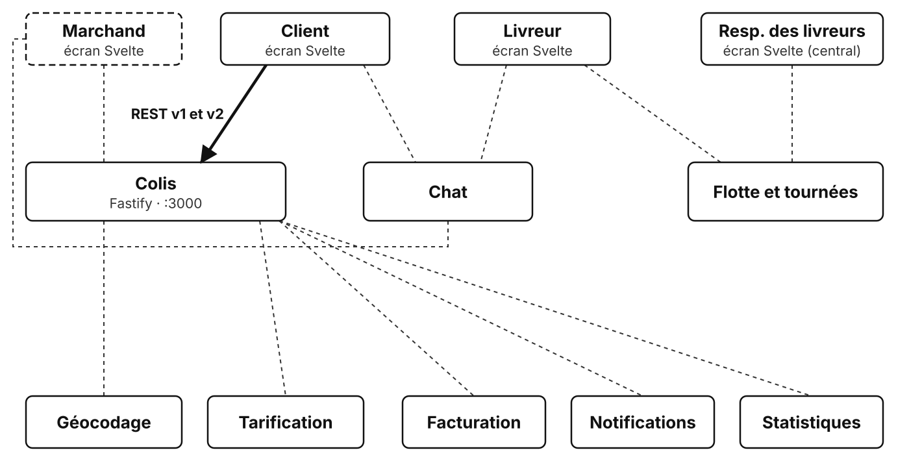
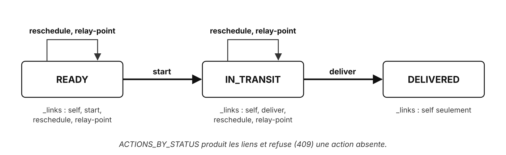

# TP2 : v2 HATEOAS

## Contexte

> **De :** Mona Bilité, directrice technique · **Objet :** deux applis, une API
>
> Bonjour à tous,
>
> La nouvelle appli mobile sort la semaine prochaine. Problème : un tiers de nos clients garde l'ancienne, branchée sur la v1. On ne la casse pas.
>
> Deuxième problème : l'équipe mobile me demande la liste des règles « quel bouton afficher selon le statut ». Je refuse qu'elles soient codées deux fois. Le serveur sait ce qui est possible : qu'il le dise.
>
> Donc : une v2 qui propose elle-même les actions, et une v1 qui ne bouge pas.
>
> Mona

Le service colis du TP1 reste en place. Vous ajoutez une version 2 de l'API, de **niveau 3** du modèle de Richardson : chaque colis porte les liens des actions possibles (HATEOAS), au format **HAL**. Le client suit les liens, il ne construit plus les URL et ne connaît plus les règles métier.

## Objectif

Faire cohabiter deux versions d'une API, la seconde guidant le client par des liens calculés selon l'état de la ressource.



En gras : ce que ce TP ajoute au système. En pointillés : ce qui reste à construire.

## Prérequis

- TP1 terminé, ou partir de `01-depart/` (qui contient la solution du TP1) ;
- séquence « REST : rappels et positionnement » (modèle de Richardson).

## Ce qui est fourni

```text
01-depart/
  src/app.js           enregistre la v1 (/v1) et la v2 (/v2)
  src/v1.js            l'API v1 du TP1, à ne pas modifier
  src/v2.js            l'API v2 : étapes 1 à 4, c'est ici que vous travaillez
  test/v1.test.js      tests de la v1 (12, tous passent)
  test/v2.test.js      tests de la v2 (3 sur 10 passent au départ)
  bruno/               collection du TP1, plus une requête v2 ; à compléter
```

`src/v2.js` contient déjà la règle métier, sous forme de deux tables :

```js
// Actions proposées selon le statut
const ACTIONS_BY_STATUS = {
  READY: ['start', 'reschedule', 'relay-point'],
  IN_TRANSIT: ['deliver', 'reschedule', 'relay-point'],
  DELIVERED: [],
};

// Effet de chaque action sur le colis
const EFFECTS = { start: ..., deliver: ..., reschedule: ..., 'relay-point': ... };
```



La réponse attendue pour un colis en cours de livraison :

```json
{
  "id": "CLB-0003",
  "status": "IN_TRANSIT",
  "...": "les autres champs du colis",
  "_links": {
    "self": { "href": "/v2/parcels/CLB-0003" },
    "deliver": { "href": "/v2/parcels/CLB-0003/deliver", "method": "POST" },
    "reschedule": { "href": "/v2/parcels/CLB-0003/reschedule", "method": "POST" },
    "relay-point": { "href": "/v2/parcels/CLB-0003/relay-point", "method": "POST" }
  }
}
```

Les écrans web ([http://localhost:5173](http://localhost:5173)) :

| Écran | Adresse | Au TP2 | Ce qui le fait fonctionner |
| --- | --- | --- | --- |
| **Client** | [http://localhost:5173/#/client](http://localhost:5173/#/client) | ✅ utilisable en `v1` et en `v2` | en `v2`, un bouton par lien reçu (étapes 2 et 3) |
| **Central** | [http://localhost:5173/#/central](http://localhost:5173/#/central) | ✅ utilisable | API v1, inchangée |
| **Livreur** | [http://localhost:5173/#/livreur](http://localhost:5173/#/livreur) | 🚧 « Écran en préparation » | TP5 |
| **Marchand** | [http://localhost:5173/#/marchand](http://localhost:5173/#/marchand) | 🚧 « Écran en préparation » | TP7 |

L'écran **Client** en `v2` ne contient aucune règle métier : il affiche un bouton par lien reçu, et suit le lien au clic.

## Travail demandé

### Mise en route

1. Dans `01-depart/`, lancer `docker compose up` : les conteneurs du TP1 sont remplacés.
2. Ouvrir l'écran **Client**, choisir `v2`, suivre `CLB-0003` : la fiche s'affiche, avec « Aucune action proposée par le serveur ».
3. Lancer `docker compose exec parcels npm test` : 14 tests sur 22 passent.

### Étape 1 : le lien self

Dans `toHal()`, ajouter à la copie du colis un objet `_links` avec le lien `self` : `{ "self": { "href": "/v2/parcels/CLB-0003" } }`.

<details>
<summary>💡 Comment ajouter un champ à la copie ?</summary>

`{ ...parcel }` copie le colis dans un nouvel objet.

Un champ s'ajoute dans le même objet : `{ ...parcel, _links: ... }`.

Ne pas modifier `parcel` lui-même : c'est le colis partagé par les deux versions, la v1 renverrait aussi les liens.

<details>
<summary>📖 Que lire dans la documentation ?</summary>

- [Syntaxe de décomposition (*spread*)](https://developer.mozilla.org/fr/docs/Web/JavaScript/Reference/Operators/Spread_syntax) (MDN) : `...` dans un objet littéral recopie les champs d'un autre objet.
- [JSON Hypertext Application Language](https://datatracker.ietf.org/doc/html/draft-kelly-json-hal) (IETF) : le format HAL, ses `_links` et son `_embedded`.

<details>
<summary>🆘 Toujours coincé ?</summary>

```js
function toHal(parcel) {
  const self = `/v2/parcels/${parcel.id}`;
  const links = { self: { href: self } };

  // Spread (...) : une copie du colis, enrichie de _links ; parcel n'est pas modifié
  return { ...parcel, _links: links };
}
```

</details>
</details>
</details>

### Étape 2 : un lien par action possible

Compléter `toHal()` : pour chaque action de `ACTIONS_BY_STATUS[parcel.status]`, ajouter un lien `{ href: '/v2/parcels/<id>/<action>', method: 'POST' }`. Dans l'écran **Client**, les boutons apparaissent.

<details>
<summary>💡 Comment construire l'objet des liens ?</summary>

Le nom de chaque lien est celui de l'action : il n'est connu qu'à l'exécution.

```text
liens = { self }
pour chaque action permise par le statut du colis :
  liens[nom de l'action] = { href : adresse du colis / action, method : POST }
renvoyer la copie du colis, avec ces liens
```

Un colis `DELIVERED` n'a aucune action : il ne garde que `self`.

<details>
<summary>📖 Que lire dans la documentation ?</summary>

- [`for...of`](https://developer.mozilla.org/fr/docs/Web/JavaScript/Reference/Statements/for...of) (MDN) : parcourir les éléments d'un tableau.
- [Accesseurs de propriété](https://developer.mozilla.org/fr/docs/Web/JavaScript/Reference/Operators/Property_accessors) (MDN) : `links[action]`, une propriété dont le nom est dans une variable.
- `ACTIONS_BY_STATUS` dans le fichier de la v2 : à lire, un tableau d'actions par statut.

<details>
<summary>🆘 Toujours coincé ?</summary>

```js
function toHal(parcel) {
  const self = `/v2/parcels/${parcel.id}`;
  const links = { self: { href: self } };

  // Un lien par action que le statut actuel permet : le client n'affiche que ce qui est possible
  for (const action of ACTIONS_BY_STATUS[parcel.status]) {
    // Accès par crochets : le nom de la propriété est la valeur de action (start, deliver…)
    links[action] = { href: `${self}/${action}`, method: 'POST' };
  }

  return { ...parcel, _links: links };
}
```

</details>
</details>
</details>

### Étape 3 : exécuter une action

Compléter la route `POST /v2/parcels/:id/:action`, qui répond pour l'instant `501` :

- `404` si l'action n'existe pas dans `EFFECTS`, ou si le colis n'existe pas ;
- `409` si le statut du colis ne propose pas cette action ;
- sinon, appliquer l'effet, mettre à jour `updatedAt`, renvoyer le colis au format HAL.

Dans l'écran **Client**, un clic sur « Mettre en livraison » fait changer les boutons.

<details>
<summary>💡 Comment lire l'action et vérifier qu'elle est permise ?</summary>

Les deux paramètres de l'URL se lisent dans `request.params`.

Trois gardes, puis l'effet :

```text
si l'action n'existe pas dans EFFECTS : 404
chercher le colis ; si absent : 404
si le statut du colis ne propose pas cette action : 409
appliquer l'effet de l'action au colis, mettre à jour la date
renvoyer le colis au format HAL
```

La même table, `ACTIONS_BY_STATUS`, produit les liens et contrôle les actions : le serveur ne peut pas proposer une action qu'il refuserait.

<details>
<summary>📖 Que lire dans la documentation ?</summary>

- [Affecter par décomposition](https://developer.mozilla.org/fr/docs/Web/JavaScript/Reference/Operators/Destructuring) (MDN) : `const { id, action } = request.params`.
- [`Array.prototype.includes()`](https://developer.mozilla.org/fr/docs/Web/JavaScript/Reference/Global_Objects/Array/includes) (MDN) : un tableau contient-il cette valeur ?
- `EFFECTS` dans le fichier de la v2 : à lire, une fonction par action ; `EFFECTS[action]` vaut `undefined` pour une action inconnue.

<details>
<summary>🆘 Toujours coincé ?</summary>

```js
app.post('/parcels/:id/:action', async (request, reply) => {
  // Décomposition : les deux paramètres de chemin en une ligne
  const { id, action } = request.params;

  // Action inconnue : la ressource /parcels/:id/:action n'existe pas
  if (!EFFECTS[action]) {
    return sendProblem(reply, 404, 'Action inconnue', `Aucune action ${action}`);
  }
  const parcel = findParcel(id);
  if (!parcel) {
    return sendProblem(reply, 404, 'Colis introuvable', `Aucun colis ${id}`);
  }

  // Même table que pour les liens : une action non proposée est refusée
  if (!ACTIONS_BY_STATUS[parcel.status].includes(action)) {
    return sendProblem(reply, 409, 'Action impossible', `Un colis ${parcel.status} ne propose pas l'action ${action}`);
  }

  // EFFECTS[action] est une fonction : on l'appelle avec le colis
  EFFECTS[action](parcel);
  parcel.updatedAt = new Date().toISOString();

  // Réponse en HAL : le client reçoit les nouveaux liens, donc les nouveaux boutons
  return toHal(parcel);
});
```

</details>
</details>
</details>

### Étape 4 : la collection

Compléter la route `GET /v2/parcels`, qui répond pour l'instant `501` : en HAL, une collection porte son lien `self` et range ses éléments dans `_embedded`.

```json
{
  "_links": { "self": { "href": "/v2/parcels" } },
  "_embedded": { "parcels": [ { "id": "CLB-0001", "...": "...", "_links": { "...": "..." } } ] }
}
```

<details>
<summary>💡 Comment transformer toute la liste ?</summary>

Chaque colis de la collection doit passer par `toHal()`, comme un colis seul.

`parcels.map(toHal)` applique `toHal()` à chaque colis et renvoie un nouveau tableau.

<details>
<summary>📖 Que lire dans la documentation ?</summary>

- [`Array.prototype.map()`](https://developer.mozilla.org/fr/docs/Web/JavaScript/Reference/Global_Objects/Array/map) (MDN) : un nouveau tableau, avec le résultat de la fonction pour chaque élément.
- [JSON Hypertext Application Language](https://datatracker.ietf.org/doc/html/draft-kelly-json-hal) (IETF) : `_embedded`, les ressources incluses dans une autre.

<details>
<summary>🆘 Toujours coincé ?</summary>

```js
app.get('/parcels', async () => {
  return {
    // La collection est une ressource : elle a son propre lien self
    _links: { self: { href: '/v2/parcels' } },
    // map(toHal) : la fonction elle-même est passée, map l'appelle pour chaque colis
    _embedded: { parcels: parcels.map(toHal) },
  };
});
```

</details>
</details>
</details>

### Vérifications

1. `npm test` : les 22 tests passent, dont les 12 de la v1, qui n'a pas bougé.
2. Compléter la collection Bruno : une action réussie, une action refusée (`409`), la collection v2. Comparer `GET /v1/parcels/CLB-0003` et `GET /v2/parcels/CLB-0003`.
3. Dans l'écran **Client**, en `v2`, suivre `CLB-0002` :
   - au départ (`READY`) : « Mettre en livraison », « Reprogrammer la livraison », « Livrer en point relais » ;
   - « Livrer en point relais » : la ligne « Option de livraison » apparaît ;
   - « Mettre en livraison » puis « Marquer livré » : plus aucune action proposée.
4. Basculer l'écran en `v1` : le même colis s'affiche, sans boutons.

### Pour aller plus loin

1. Annoncer la fin de la v1 : ajouter à toutes ses réponses les en-têtes `Deprecation` ([RFC 9745](https://www.rfc-editor.org/rfc/rfc9745)) et `Sunset` ([RFC 8594](https://www.rfc-editor.org/rfc/rfc8594)), avec un hook `onSend` dans `v1.js`.
2. Ajouter à la collection v2 le filtre `?status=` du TP1, et un lien `next` si la liste est paginée.

## Points de vigilance

- `toHal()` renvoie une **copie** : modifier `parcel` ajouterait les liens dans la v1 et dans les données ;
- la v1 continue de fonctionner à l'identique : ses tests sont le filet de sécurité ;
- un champ ajouté au colis (`deliveryOption`) apparaît aussi en v1 : c'est une évolution compatible, un ancien client ignore un champ qu'il ne connaît pas ;
- `404` pour une action qui n'existe pas, `409` pour une action qui existe mais n'est pas permise dans cet état.

## Commandes utiles

```bash
docker compose up                          # démarrer (Ctrl+C pour arrêter)
docker compose exec parcels npm test       # lancer les tests automatiques
curl -s http://localhost:3000/v2/parcels/CLB-0003                 # un colis en v2
curl -s -X POST http://localhost:3000/v2/parcels/CLB-0002/start   # suivre un lien
```

## Résultat attendu

- `npm test` : 22 tests sur 22 passent ;
- `/v1` et `/v2` répondent côte à côte, la v1 sans changement ;
- les liens d'un colis changent avec son statut, et un colis livré n'en propose plus ;
- l'écran **Client** en `v2` affiche les actions proposées par le serveur, sans connaître les règles.
