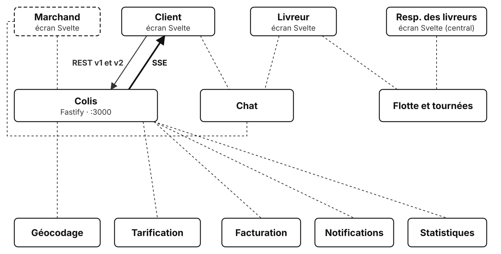
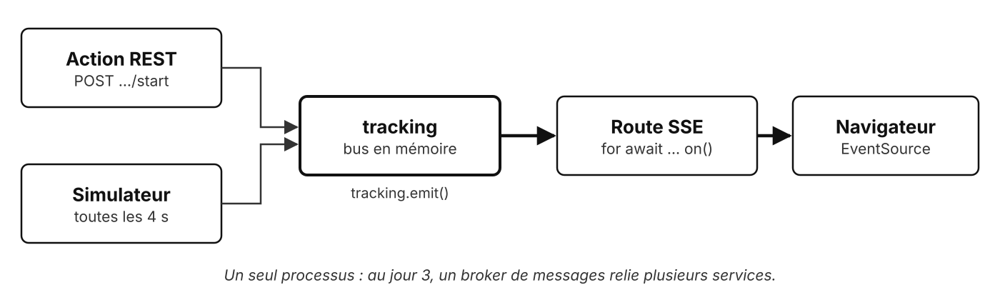

# TP3 : Flux réactif des événements d'un colis

## Contexte

> **De :** Anne Onyme, support client · **Objet :** RE: « Où est mon colis ? »
>
> Bonjour,
>
> Depuis la v2, les appels ont baissé. Merci. Mais les clients ont trouvé une nouvelle habitude : ils appuient sur « Suivre » toutes les dix secondes. Mona dit que le serveur reçoit des milliers de requêtes pour rien.
>
> Ce qu'ils veulent, c'est voir le colis avancer, comme une pizza sur l'appli du livreur. Sans rien faire.
>
> Anne

Interroger l'API à intervalle régulier (polling) gaspille des requêtes et ajoute de la latence. Vous ajoutez au service colis un flux **Server-Sent Events** (SSE) : le navigateur ouvre une connexion HTTP qui reste ouverte, et le serveur y pousse chaque étape du colis dès qu'elle survient. Le flux est écrit avec une boucle `for await` qui attend chaque événement, dans une syntaxe proche du code habituel.

## Objectif

Exposer un endpoint non bloquant qui renvoie un flux d'événements, et le fermer proprement.



En gras : ce que ce TP ajoute au système. En pointillés : ce qui reste à construire.

## Prérequis

- TP2 terminé, ou partir de `01-depart/` (qui contient la solution du TP2) ;
- séquence « Introduction à la programmation réactive ».

## Ce qui est fourni

```text
01-depart/
  src/tracking.js      simulateur : les colis IN_TRANSIT avancent d'une étape toutes les 4 secondes
  src/events.js        le flux SSE : étapes 1 à 3, c'est ici que vous travaillez ; send(), fournie, se lit à l'étape 4
  src/app.js           enregistre la v1, la v2 et le flux (/v2/parcels/:id/events)
  test/events.test.js  tests du flux (1 sur 5 passe au départ)
```

La requête qui change un colis et la requête SSE qui le suit sont deux requêtes distinctes : il faut un intermédiaire entre les deux. C'est `tracking`, un **bus d'événements en mémoire** (un `EventEmitter` de Node) : celui qui publie ne connaît pas ceux qui écoutent.



Deux sources publient, déjà écrites :

- `src/v2.js` : chaque action (« Mettre en livraison », « Livrer »…) publie un événement ;
- `src/tracking.js` : un simulateur joue le livreur et publie une étape toutes les 4 secondes pour chaque colis en cours de livraison.

```js
tracking.emit('event', { parcelId: 'CLB-0003', status: 'IN_TRANSIT', label: 'Livreur à 5 minutes', at: '2026-11-02T10:42:00.000Z' });
```

Une livraison simulée compte quatre étapes ; la dernière passe le colis en `DELIVERED`. Les colis déjà `IN_TRANSIT` au démarrage sont donc livrés en 16 secondes : pour suivre une livraison du début à la fin, partir d'un colis `READY` et le mettre en livraison.

Ce bus ne vit que dans le processus : avec deux instances du service colis, un événement publié sur l'une n'atteint pas les clients connectés à l'autre. Au jour 3, un broker de messages (RabbitMQ) joue ce rôle entre services.

Ce que le serveur doit écrire, au format `text/event-stream` : un bloc `data:` par événement, suivi d'une ligne vide.

```text
data: {"parcelId":"CLB-0001","status":"READY","label":"État actuel","at":"2026-11-02T08:05:00.000Z"}

data: {"parcelId":"CLB-0001","status":"IN_TRANSIT","label":"Colis chargé sur le vélo cargo","at":"..."}

```

Les écrans web ([http://localhost:5173](http://localhost:5173)) :

| Écran | Adresse | Au TP3 | Ce qui le fait fonctionner |
| --- | --- | --- | --- |
| **Client** | [http://localhost:5173/#/client](http://localhost:5173/#/client) | ✅ en `v2`, encadré « Suivi en direct » | étape 1 (état actuel), étape 2 (étapes en direct) |
| **Central** | [http://localhost:5173/#/central](http://localhost:5173/#/central) | ✅ utilisable | API v1 |
| **Livreur** | [http://localhost:5173/#/livreur](http://localhost:5173/#/livreur) | 🚧 « Écran en préparation » | TP5 |
| **Marchand** | [http://localhost:5173/#/marchand](http://localhost:5173/#/marchand) | 🚧 « Écran en préparation » | TP7 |

Côté navigateur, le flux est consommé par `clients/src/api/events.js`, fourni : une vingtaine de lignes autour d'`EventSource`, à lire.

## Travail demandé

### Mise en route

1. Dans `01-depart/`, lancer `docker compose up`.
2. Lancer `docker compose exec parcels npm test` : 23 tests sur 27 passent (les 22 du TP2, et 1 sur 5 pour le flux).
3. Ouvrir `src/tracking.js` et repérer `tracking.emit(...)` : c'est la source des événements.

### Étape 1 : ouvrir le flux

Compléter la route `GET /v2/parcels/:id/events`, qui répond pour l'instant `501` :

- `404` au format problème si le colis n'existe pas ;
- sinon, en-têtes `Content-Type: text/event-stream` et `Cache-Control: no-cache`, un premier événement avec l'état actuel du colis (`label: 'État actuel'`), puis fin de la réponse.

Vérifier avec `curl -N http://localhost:3000/v2/parcels/CLB-0001/events` : un bloc `data:`, puis la commande rend la main.

<details>
<summary>💡 Comment écrire la réponse soi-même avec Fastify ?</summary>

D'habitude, Fastify envoie ce que renvoie le handler, **en une fois**.

Un flux, lui, s'écrit **morceau par morceau** : il faut reprendre la main sur la réponse.

Le déroulé de la route :

```text
chercher le colis
si absent : répondre 404 au format problème, et s'arrêter là
dire à Fastify de ne plus rien envoyer
écrire le code 200 et les en-têtes du flux
envoyer l'état actuel du colis
terminer la réponse
```

<details>
<summary>📖 Que lire dans la documentation ?</summary>

- [`reply.hijack()`](https://fastify.dev/docs/latest/Reference/Reply/#hijack) (Fastify) : Fastify n'envoie plus rien, la réponse est à toi.
- [`reply.raw`](https://fastify.dev/docs/latest/Reference/Reply/#raw) (Fastify) : la réponse HTTP de Node, cachée sous celle de Fastify.
- [`response.writeHead()`](https://nodejs.org/api/http.html#responsewriteheadstatuscode-statusmessage-headers) (Node) : envoie le code et les en-têtes.
- [`response.end()`](https://nodejs.org/api/http.html#responseenddata-encoding-callback) (Node) : termine la réponse ; `curl` rend alors la main.
- [Utiliser les Server-Sent Events](https://developer.mozilla.org/fr/docs/Web/API/Server-sent_events/Using_server-sent_events) (MDN) : le format `text/event-stream`, côté serveur et côté navigateur.

Pour écrire un événement, `send(reply.raw, event)` est fourni : il produit le bloc `data: …` suivi de la ligne vide.

<details>
<summary>🆘 Toujours coincé ?</summary>

```js
app.get('/parcels/:id/events', async (request, reply) => {
  const parcel = findParcel(request.params.id);

  // Retour anticipé : sans colis, réponse d'erreur, et la suite du handler ne s'exécute pas
  if (!parcel) {
    return sendProblem(reply, 404, 'Colis introuvable', `Aucun colis ${request.params.id}`);
  }

  // Fastify n'enverra plus rien : la réponse s'écrit à la main sur reply.raw
  reply.hijack();

  // text/event-stream annonce un flux ; no-cache empêche un intermédiaire de le garder en mémoire
  reply.raw.writeHead(200, { 'Content-Type': 'text/event-stream', 'Cache-Control': 'no-cache' });

  // Premier événement : l'état actuel ; await, car send() est asynchrone (voir l'étape 4)
  await send(reply.raw, { parcelId: parcel.id, status: parcel.status, label: 'État actuel', at: parcel.updatedAt });

  // Fin de la réponse : la connexion se ferme
  reply.raw.end();
});
```

</details>
</details>
</details>

### Étape 2 : pousser les événements du colis

Dans la route, entre le premier événement et `end()`, une boucle `for await` attend les événements de `tracking` et envoie ceux du colis demandé. Un colis déjà livré n'a rien à attendre : pas de boucle.

Vérifier avec `curl -N` sur `CLB-0001`, puis le mettre en livraison depuis un autre terminal (`curl -X POST http://localhost:3000/v2/parcels/CLB-0001/start`) : « Colis mis en livraison » arrive aussitôt, puis une étape toutes les 4 secondes. Le flux ne s'arrête pas encore : `Ctrl+C`.

<details>
<summary>💡 Comment transformer des événements en boucle ?</summary>

`tracking` émet les événements de **tous** les colis : la boucle doit ignorer ceux des autres.

`on()` transforme les émissions en une suite de valeurs qu'une boucle `for await` parcourt, en attendant chacune.

```text
dans la route, après l'état actuel :
  si le colis n'est pas livré :
    pour chaque événement émis par tracking (en l'attendant) :
      s'il concerne un autre colis : passer au suivant
      l'envoyer
```

<details>
<summary>📖 Que lire dans la documentation ?</summary>

- [`events.on()`](https://nodejs.org/api/events.html#eventsonemitter-eventname-options) (Node, `node:events`, déjà importé) : transforme les émissions d'un `EventEmitter` en **itérable asynchrone**, à parcourir avec `for await`.
- [`for await...of`](https://developer.mozilla.org/fr/docs/Web/JavaScript/Reference/Statements/for-await...of) (MDN) : une boucle qui attend chaque valeur avant de tourner.
- [Affecter par décomposition](https://developer.mozilla.org/fr/docs/Web/JavaScript/Reference/Operators/Destructuring) (MDN) : `on()` livre les arguments de chaque `emit` dans un tableau ; `const [event]` en prend le premier.
- [`continue`](https://developer.mozilla.org/fr/docs/Web/JavaScript/Reference/Statements/continue) (MDN) : passe directement au tour de boucle suivant.

<details>
<summary>🆘 Toujours coincé ?</summary>

Dans la route, à la place de la seule ligne `reply.raw.end()` :

```js
// Un colis déjà livré n'aura plus d'événement : inutile d'attendre
if (parcel.status !== 'DELIVERED') {
  // on() : chaque tracking.emit('event', ...) devient un tour de boucle
  // [event] : décomposition, le premier argument de emit()
  for await (const [event] of on(tracking, 'event')) {
    // Un autre colis : on l'ignore et on attend le suivant
    if (event.parcelId !== parcel.id) {
      continue;
    }
    await send(reply.raw, event);
  }
}
reply.raw.end();
```

</details>
</details>
</details>

### Étape 3 : fermer le flux proprement

Deux cas de fin :

- **le colis est livré**, à écrire : la boucle voit passer `DELIVERED`, elle s'arrête juste après avoir envoyé cet événement ;
- **le client se déconnecte**, fourni ci-dessous : la route voit la connexion se fermer et arrête l'attente. Sans cela, chaque onglet fermé laisse un abonné à `tracking` en mémoire, pour toujours.

Pour la déconnexion, recopier ce code à la place de la boucle de l'étape 2, puis le relire :

```js
if (parcel.status !== 'DELIVERED') {
  // AbortController : la fermeture de la connexion (close) annule le signal
  const controller = new AbortController();
  reply.raw.on('close', () => controller.abort());

  try {
    // { signal } : quand il est annulé, on() arrête d'attendre
    for await (const [event] of on(tracking, 'event', { signal: controller.signal })) {
      // ... le corps de la boucle de l'étape 2, inchangé
    }
  } catch (error) {
    // Signal annulé : on() lève une AbortError, qui veut dire ici « client parti », une fin normale
    if (error.name !== 'AbortError') {
      throw error;
    }
  }
}
reply.raw.end();
```

<details>
<summary>💡 Comment sortir de la boucle à la livraison ?</summary>

Une instruction arrête la boucle `for await` : `on()` se désabonne alors de `tracking`.

```text
pour chaque événement du colis :
  l'envoyer
  si le colis est livré : sortir de la boucle
```

Envoyer d'abord, sortir ensuite : le client doit recevoir l'événement `DELIVERED`.

<details>
<summary>📖 Que lire dans la documentation ?</summary>

- [`break`](https://developer.mozilla.org/fr/docs/Web/JavaScript/Reference/Statements/break) (MDN) : sort de la boucle ; avec `for await`, l'itérable est prévenu et libère ce qu'il tenait.

Pour comprendre le code fourni :

- [`AbortController`](https://developer.mozilla.org/fr/docs/Web/API/AbortController) (MDN) : `controller.abort()` annule, `controller.signal` transmet l'annulation à qui l'écoute.
- [`events.on()`](https://nodejs.org/api/events.html#eventsonemitter-eventname-options) (Node) : l'option `{ signal }` arrête l'attente quand le signal est annulé, en levant une erreur `AbortError`.
- [Événement `close`](https://nodejs.org/api/http.html#event-close-2) de la réponse (Node) : émis quand la connexion se ferme, livraison terminée ou client parti.
- [`try...catch`](https://developer.mozilla.org/fr/docs/Web/JavaScript/Reference/Statements/try...catch) (MDN) : intercepter l'`AbortError`, qui signale ici une fin normale.

<details>
<summary>🆘 Toujours coincé ?</summary>

Le corps de la boucle :

```js
if (event.parcelId !== parcel.id) {
  continue;
}
await send(reply.raw, event);

// Colis livré : break sort de la boucle, et on() se désabonne de tracking
if (event.status === 'DELIVERED') {
  break;
}
```

</details>
</details>
</details>

### Étape 4 : lire la back-pressure

Si le client lit moins vite que le serveur n'écrit, les données s'accumulent dans un tampon en mémoire. La fonction `send()`, fournie complète, en tient compte : la lire, puis répondre.

1. Que renvoie `raw.write()` quand le tampon est plein ?
2. Que fait alors `send()`, et jusqu'à quand ?
3. Pourquoi la boucle `for await` attend-elle, elle aussi ?
4. Si `send()` se contentait d'appeler `write()`, que deviendrait la mémoire du serveur face à un client lent ?

<details>
<summary>📖 Que lire dans la documentation ?</summary>

- [`writable.write()`](https://nodejs.org/api/stream.html#writablewritechunk-encoding-callback) (Node) : la valeur renvoyée, `false` quand le tampon a dépassé sa limite.
- [Événement `drain`](https://nodejs.org/api/stream.html#event-drain) (Node) : émis quand le tampon s'est vidé et qu'on peut écrire à nouveau.
- [`events.once()`](https://nodejs.org/api/events.html#eventsonceemitter-name-options) (Node) : une promesse résolue à la prochaine émission d'un événement, à attendre avec `await`.

<details>
<summary>🆘 Les réponses</summary>

1. `false` : les données sont quand même gardées, mais le tampon a dépassé sa limite.
2. Elle attend l'événement `drain` avec `once()` : sa promesse ne se résout que quand le tampon s'est vidé.
3. La boucle attend chaque `send()` (`await`) : tant que `send()` n'a pas fini, elle ne demande pas l'événement suivant à `on()`, qui le garde en attente.
4. Elle grossirait sans limite : les événements s'empileraient dans le tampon, plus vite que le client ne les lit.

</details>
</details>

### Vérifications

1. `npm test` : les 27 tests passent.
2. Écran **Client** ([#/client](http://localhost:5173/#/client)), en `v2`, suivre `CLB-0001` : l'encadré « Suivi en direct » affiche l'état actuel. Cliquer « Mettre en livraison » : « Colis mis en livraison » s'affiche, puis une étape toutes les 4 secondes ; la fiche (statut, boutons) se met à jour, et à la livraison il ne reste aucune action.
3. Ouvrir l'écran **Client** dans deux onglets sur le même colis `READY`, et le mettre en livraison depuis le premier : le second se met à jour sans rien faire. C'est le bus `tracking` qui relie l'action REST d'un client au flux SSE de l'autre.
4. Pendant une livraison, arrêter le service colis (`docker compose stop parcels`) puis le relancer (`docker compose start parcels`) : `EventSource` se reconnecte seul (onglet Réseau des outils de développement).
5. Lire `clients/src/api/events.js` : pourquoi le client appelle-t-il `close()` à la livraison ?

### Pour aller plus loin

1. Réécrire le flux avec RxJS (`npm install rxjs` dans le conteneur) : un `Observable` construit avec `fromEvent`, puis les opérateurs `filter`, `takeWhile` et `takeUntil`. Que devient la back-pressure ?

   <details>
   <summary>🆘 Une solution</summary>

   ```js
   import { filter, fromEvent, takeUntil, takeWhile } from 'rxjs';

   // Les événements d'un colis, jusqu'à la livraison (incluse) ou la déconnexion du client
   function parcelEvents$(id, raw) {
     return fromEvent(tracking, 'event').pipe(
       filter((event) => event.parcelId === id),
       takeWhile((event) => event.status !== 'DELIVERED', true),
       takeUntil(fromEvent(raw, 'close')),
     );
   }

   // Dans la route, à la place de la boucle for await :
   await new Promise((resolve) => {
     parcelEvents$(parcel.id, reply.raw).subscribe({ next: (event) => send(reply.raw, event), complete: resolve });
   });
   ```

   L'`Observable` pousse les événements sans attendre que `send()` ait fini : la back-pressure est perdue.

   </details>

2. Écrire un petit programme Node, hors navigateur, qui suit un colis : `fetch()` sur le flux, puis lecture de `response.body` morceau par morceau avec `for await`.
3. Réécrire la route avec la bibliothèque `@fastify/sse` (`npm install @fastify/sse` dans le conteneur, puis `app.register(sse)` dans `app.js`). Que reste-t-il à écrire soi-même ?

   <details>
   <summary>🆘 Une solution</summary>

   ```js
   // sse: 'only' : la route ne sert que du SSE, même si la requête n'envoie pas Accept: text/event-stream
   app.get('/parcels/:id/events', { sse: 'only' }, async (request, reply) => {
     const parcel = findParcel(request.params.id);
     if (!parcel) {
       return sendProblem(reply, 404, 'Colis introuvable', `Aucun colis ${request.params.id}`);
     }
     await reply.sse.send({ data: { parcelId: parcel.id, status: parcel.status, label: 'État actuel', at: parcel.updatedAt } });
     if (parcel.status === 'DELIVERED') {
       return;
     }
     const controller = new AbortController();
     reply.sse.onClose(() => controller.abort());
     try {
       for await (const [event] of on(tracking, 'event', { signal: controller.signal })) {
         if (event.parcelId !== parcel.id) {
           continue;
         }
         await reply.sse.send({ data: event });
         if (event.status === 'DELIVERED') {
           break;
         }
       }
     } catch (error) {
       if (error.name !== 'AbortError') {
         throw error;
       }
     }
   });
   ```

   En-têtes, format `data: …` et back-pressure sont pris en charge par le plugin, qui ferme le flux quand la fonction se termine. Il reste le métier (quel colis, quels événements) et l'arrêt de l'attente à la déconnexion. Avec `{ sse: true }`, une requête sans en-tête `Accept: text/event-stream` (les tests, `curl`) n'a pas de `reply.sse` : erreur 500. Les tests du TP passent avec cette variante (vérifié avec `@fastify/sse` 0.6).

   </details>

## Points de vigilance

- `curl` sans `-N` met la réponse en tampon : les événements semblent ne jamais arriver ;
- chaque enregistrement redémarre le serveur et coupe les flux ouverts : `EventSource` se reconnecte, `curl` non ;
- sans `reply.hijack()`, Fastify tente d'envoyer sa propre réponse après la vôtre ;
- une boucle `for await` qui ne se termine jamais garde un abonné à `tracking` : le test « client déconnecté » le détecte ;
- des bibliothèques simplifient ce travail : `@fastify/sse` prend en charge en-têtes, format, back-pressure et déconnexion (voir « Pour aller plus loin »).

## Commandes utiles

```bash
docker compose up                                                # démarrer
docker compose exec parcels npm test                             # tests automatiques
curl -N http://localhost:3000/v2/parcels/CLB-0001/events          # suivre un flux (Ctrl+C pour quitter)
curl -X POST http://localhost:3000/v2/parcels/CLB-0001/start      # mettre un colis en livraison
docker compose restart parcels                                   # remettre les données à zéro
```

## Résultat attendu

- `npm test` : 27 tests sur 27 passent ;
- `curl -N` affiche les étapes d'un colis au fil de l'eau, et rend la main à la livraison ;
- l'écran **Client** affiche les étapes en direct, sans rechargement ;
- un client qui se déconnecte ne laisse aucun abonné derrière lui.
