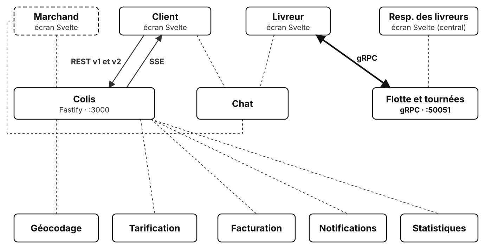

# TP4 : Positions des livreurs

## Contexte

> **De :** Rémi Fasol, responsable des livreurs · **Objet :** la flotte à l'aveugle
>
> Salut,
>
> Aujourd'hui, quand un colis s'ajoute à une tournée ou qu'une rue est fermée, j'appelle le livreur. Sur un vélo cargo, dans la circulation. Il ne décroche pas, évidemment.
>
> Il me faut deux choses : voir où est chaque livreur, en continu ; et lui envoyer sa tournée corrigée dès qu'il y a un imprévu, sans attendre qu'il demande.
>
> Les applis des livreurs envoient déjà leur position chaque seconde. Il manque le central qui écoute et qui répond.
>
> Rémi

Le contrat entre les livreurs et le central est un fichier `.proto` : une seule méthode, `Track`, en **streaming bidirectionnel** gRPC. Chaque livreur ouvre un flux et y écrit ses positions ; le central lui répond sur le même appel, quand il le décide. Les deux flux sont indépendants : le livreur n'attend pas de réponse pour envoyer la position suivante.

Ce TP est un service à part, sans lien avec le service colis des TP1 à TP3.

## Objectif

Implémenter côté serveur une méthode gRPC en streaming bidirectionnel : recevoir un flux, répondre sur l'autre, gérer la fin du flux.



En gras : ce que ce TP ajoute au système. En pointillés : ce qui reste à construire.

## Prérequis

- séquence « gRPC : principes » et la démo du streaming bidirectionnel ;
- Docker et VS Code (voir le [README des TP](../README.md)).

## Ce qui est fourni

```text
01-depart/
  docker-compose.yml   le central (port 50051) et le simulateur de livreurs
  proto/tracking.proto le contrat : service Tracking, messages Position et Instruction
  src/proto.js         chargement dynamique du .proto (sans génération de code)
  src/app.js           création du serveur gRPC, la méthode Track branchée sur track()
  src/server.js        démarrage, imprévus toutes les 8 secondes, état de la flotte affiché toutes les 5 secondes
  src/incidents.js     imprévus de la journée (incidents.emit('incident', ...))
  src/couriers.js      simulateur : Lina, Hugo et Zoé envoient leur position chaque seconde
  src/fleet.js         track() : étapes 1 à 5, c'est ici que vous travaillez
  test/fleet.test.js   tests du central (0 sur 5 passe au départ)
```

Le contrat :

```protobuf
service Tracking {
  rpc Track (stream Position) returns (stream Instruction);
}

message Position {
  string courier_id = 1;
  double latitude = 2;
  double longitude = 3;
  int64 sent_at = 4;
}

message Instruction {
  string text = 1;
  repeated string parcel_ids = 2;
}
```

Côté JavaScript, les champs passent en camelCase : `position.courierId`, `position.sentAt`, `{ text, parcelIds }`.

Un imprévu, émis par `src/incidents.js` :

```js
incidents.emit('incident', { courierId: 'hugo', text: 'Rue de la République fermée, ...', parcelIds: ['CLB-0003', 'CLB-0008'] });
```

Les écrans web ne servent pas dans ce TP : un navigateur ne sait pas ouvrir un flux gRPC bidirectionnel (il faudrait une passerelle gRPC-Web). Tout se lit dans les journaux des deux conteneurs.

## Travail demandé

### Mise en route

1. Dans `01-depart/`, lancer `docker compose up --remove-orphans` : les conteneurs du TP3 sont arrêtés, le central puis le simulateur démarrent.
2. Dans les journaux : `couriers` indique trois livreurs connectés, `fleet` affiche « État de la flotte (0 livreur(s) connecté(s)) » toutes les 5 secondes.
3. Lancer `docker compose exec fleet npm test` : 0 test sur 5 passe.

### Étape 1 : recevoir les positions

Dans `track(call)`, à chaque position reçue, enregistrer dans `positions` la dernière position du livreur : `{ latitude, longitude, delayMs }`, où `delayMs` est le temps écoulé depuis l'envoi (`Date.now() - position.sentAt`). L'état de la flotte affiche alors trois livreurs, dont les positions changent.

<details>
<summary>💡 Comment lire le flux entrant ?</summary>

`call` est un **flux Node dans les deux sens** : on y lit les positions du livreur, on y écrit les instructions du central.

Chaque message reçu déclenche l'événement `data`.

```text
à chaque position reçue sur call :
  retenir l'identifiant du livreur (les étapes suivantes en ont besoin)
  ranger dans positions, sous cet identifiant : latitude, longitude, retard
```

<details>
<summary>📖 Que lire dans la documentation ?</summary>

- [Streaming RPCs](https://grpc.io/docs/languages/node/basics/#streaming-rpcs) (gRPC, Node) : un appel bidirectionnel, où chaque côté lit et écrit sur le même `call`.
- [Événement `data`](https://nodejs.org/api/stream.html#event-data) (Node) : émis à chaque message lu sur un flux.
- [`Map`](https://developer.mozilla.org/fr/docs/Web/JavaScript/Reference/Global_Objects/Map) (MDN) : `positions.set(clé, valeur)` ajoute ou remplace la valeur d'une clé.

<details>
<summary>🆘 Toujours coincé ?</summary>

```js
// Événement data : un appel de cette fonction par position envoyée par le livreur
call.on('data', (position) => {
  // Variable du flux, gardée pour les étapes 3 et 4
  courierId = position.courierId;

  // set() remplace la position précédente : la Map ne garde que la dernière
  positions.set(courierId, {
    latitude: position.latitude,
    longitude: position.longitude,
    delayMs: Date.now() - position.sentAt,
  });
});
```

</details>
</details>
</details>

### Étape 2 : lire l'état de la flotte

Pas de code : observer les journaux de `fleet` pendant une minute.

- La colonne « retard (ms) » donne le temps entre l'envoi d'une position et son traitement : quelques millisecondes.
- Au bout de 30 secondes, Hugo termine sa tournée et ferme son flux. Que dit le simulateur ? Hugo disparaît-il de l'état de la flotte ? Les étapes 3 et 4 répondent à ces deux questions.

### Étape 3 : envoyer une instruction

Quand un imprévu concerne le livreur de ce flux, lui écrire une instruction `{ text, parcelIds }` sur le flux de réponse. Dans les journaux de `couriers`, des lignes « instruction : … » apparaissent pendant que les positions continuent de partir.

<details>
<summary>💡 Comment écrire dans le flux de réponse ?</summary>

`incidents` est un `EventEmitter` : il émet chaque imprévu, **pour tous les livreurs**.

`call.write(message)` envoie un message au livreur, sans attendre de requête de sa part.

```text
fonction d'écoute (imprévu) :
  s'il concerne le livreur de ce flux : lui écrire l'instruction sur call
s'abonner aux imprévus avec cette fonction
```

Garder la fonction d'écoute dans une constante : l'étape 4 devra la retirer.

<details>
<summary>📖 Que lire dans la documentation ?</summary>

- [`emitter.on()`](https://nodejs.org/api/events.html#emitteroneventname-listener) (Node) : abonne une fonction à un événement.
- [Streaming RPCs](https://grpc.io/docs/languages/node/basics/#streaming-rpcs) (gRPC, Node) : `call.write()` envoie un message sur le flux de réponse.
- [Fonctions fléchées](https://developer.mozilla.org/fr/docs/Web/JavaScript/Reference/Functions/Arrow_functions) (MDN) : une fonction rangée dans une constante.

<details>
<summary>🆘 Toujours coincé ?</summary>

```js
// Fonction nommée par une constante : il faudra la retirer à l'étape 4
const onIncident = (incident) => {
  // Tous les flux reçoivent tous les imprévus : chacun ne garde que ceux de son livreur
  if (incident.courierId === courierId) {
    // Le serveur écrit quand il veut : c'est l'intérêt du flux bidirectionnel
    call.write({ text: incident.text, parcelIds: incident.parcelIds });
  }
};
incidents.on('incident', onIncident);
```

</details>
</details>
</details>

### Étape 4 : gérer la fin du flux

Deux façons de partir :

- **fin normale** (événement `end`) : le livreur a fermé son flux d'envoi, comme Hugo en fin de tournée ; le central ferme le sien avec `call.end()`, sinon l'appel ne se termine jamais côté livreur ;
- **connexion coupée** (événement `cancelled`) : le livreur est parti sans prévenir ; il n'y a plus personne à qui répondre.

Dans les deux cas, retirer le livreur de `positions` et retirer l'écoute des imprévus.

<details>
<summary>💡 Pourquoi retirer l'écoute des imprévus ?</summary>

`incidents.on()` garde une référence vers la fonction d'écoute, donc vers `call`.

Sans retrait, chaque livreur parti reste en mémoire et continue de recevoir des imprévus, pour toujours : une fuite de mémoire.

Le nettoyage est le même dans les deux cas : une fonction, appelée par les deux événements.

```text
leave() :
  se désabonner des imprévus
  retirer le livreur de positions

à la fin normale (end) : leave(), puis fermer notre côté du flux
à la coupure (cancelled) : leave()
```

<details>
<summary>📖 Que lire dans la documentation ?</summary>

- [`emitter.off()`](https://nodejs.org/api/events.html#emitteroffeventname-listener) (Node) : retire une fonction d'écoute ; il faut lui passer **la même** fonction qu'à `on()`.
- [Événement `end`](https://nodejs.org/api/stream.html#event-end) (Node) : l'autre côté a fini d'écrire.
- [`writable.end()`](https://nodejs.org/api/stream.html#writableendchunk-encoding-callback) (Node) : on a fini d'écrire de notre côté.
- [`Map`](https://developer.mozilla.org/fr/docs/Web/JavaScript/Reference/Global_Objects/Map) (MDN) : `positions.delete(clé)`.

`cancelled` est propre à gRPC : l'appel a été interrompu (connexion coupée), il n'y a plus personne à qui écrire.

<details>
<summary>🆘 Toujours coincé ?</summary>

```js
// Nettoyage commun aux deux façons de partir
const leave = () => {
  // Même fonction qu'à on() : sans elle, off() ne retire rien
  incidents.off('incident', onIncident);
  positions.delete(courierId);
};

// Fin normale : le livreur a fermé son côté, le central ferme le sien
call.on('end', () => {
  leave();
  call.end();
});

// Coupure : plus personne à qui répondre, on nettoie seulement
call.on('cancelled', leave);
```

</details>
</details>
</details>

### Étape 5 : un central trop lent (back-pressure)

Simuler un central lent : passer `PROCESSING_MS` à `1500`, et, dans le gestionnaire `data`, suspendre la lecture du flux pendant ce temps (`call.pause()`, puis `call.resume()` après `PROCESSING_MS`). Observer la colonne « retard (ms) » pendant une minute, puis remettre `PROCESSING_MS` à `0`.

<details>
<summary>💡 Que se passe-t-il ?</summary>

Le livreur envoie une position par seconde, le central en lit une toutes les 1,5 secondes.

Les positions non lues s'accumulent :

- d'abord dans le tampon du flux, côté central ;
- puis dans la fenêtre de contrôle de flux de HTTP/2, qui finit par freiner l'émetteur.

Le retard grandit sans cesse : le central affiche des positions de plus en plus anciennes.

C'est la **back-pressure** : le consommateur lent impose son rythme au producteur.

Pour des positions, seule la plus récente compte : un vrai central ignorerait les anciennes plutôt que de les traiter toutes.

<details>
<summary>📖 Que lire dans la documentation ?</summary>

- [`readable.pause()`](https://nodejs.org/api/stream.html#readablepause) et [`readable.resume()`](https://nodejs.org/api/stream.html#readableresume) (Node) : suspendre puis reprendre la lecture d'un flux.
- [`setTimeout()`](https://nodejs.org/api/timers.html#settimeoutcallback-delay-args) (Node) : appeler une fonction après un délai.
- [Flow Control](https://grpc.io/docs/guides/flow-control/) (gRPC) : comment HTTP/2 freine un émetteur trop rapide.

<details>
<summary>🆘 Toujours coincé ?</summary>

À la fin du gestionnaire `data` :

```js
// Traitement lent simulé : plus aucun data n'arrive tant que le flux est en pause
if (PROCESSING_MS > 0) {
  call.pause();
  // Après le délai, la lecture reprend : la position suivante attendait dans le tampon
  setTimeout(() => call.resume(), PROCESSING_MS);
}
```

</details>
</details>
</details>

### Vérifications

1. `docker compose exec fleet npm test` : les 5 tests passent.
2. Journaux de `couriers` : des instructions arrivent pendant que les positions partent ; « [hugo] le central a fermé le flux » après sa fin de tournée.
3. Journaux de `fleet` : Hugo disparaît de l'état de la flotte après 30 secondes.
4. `docker compose stop couriers` : au bout de 5 secondes, l'état de la flotte est vide. `docker compose start couriers` : les trois livreurs reviennent.
5. `docker compose restart fleet` : le simulateur signale « connexion perdue », puis se reconnecte.

### Pour aller plus loin

1. Ajouter au `.proto` une méthode unary `GetFleet (Empty) returns (Fleet)` qui renvoie l'état de la flotte, et l'appeler depuis un petit client. Les anciens clients sont-ils cassés ?
2. Remplacer, dans le `.proto`, `double latitude = 2` par `float latitude = 2`, sans redémarrer le simulateur : que reçoit le central ? Pourquoi les numéros de champ, et non les noms, font le contrat ?

## Points de vigilance

- sans `call.end()` en réponse à `end`, l'appel reste ouvert côté livreur : Hugo n'est jamais prévenu ;
- une écoute `incidents.on()` non retirée est une fuite de mémoire : le dernier test la détecte ;
- `courierId` n'est connu qu'à la première position : un imprévu arrivé avant est ignoré ;
- le simulateur se reconnecte seul après une coupure : chaque enregistrement de `src/` redémarre le central, c'est normal de voir « connexion perdue » ;
- les champs du `.proto` en `snake_case` deviennent du `camelCase` en JavaScript (option `keepCase: false` dans `src/proto.js`).

## Commandes utiles

```bash
docker compose up --remove-orphans          # démarrer (arrête les conteneurs des TP précédents)
docker compose logs -f couriers             # journaux du simulateur
docker compose logs -f fleet                # journaux du central
docker compose exec fleet npm test          # tests automatiques
docker compose stop couriers                # couper tous les livreurs
docker compose start couriers               # les relancer
```

## Résultat attendu

- `npm test` : 5 tests sur 5 passent ;
- le central affiche l'état de la flotte, mis à jour en continu ;
- le simulateur reçoit des instructions pendant qu'il envoie ses positions ;
- un livreur qui termine sa tournée ou se déconnecte disparaît de l'état de la flotte, sans rien laisser en mémoire.
