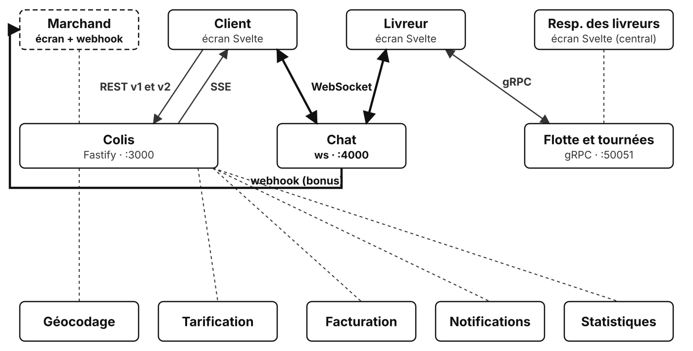

# TP5 : Chat client / livreur

## Contexte

> **De :** Anne Onyme, support client · **Objet :** « le livreur ne trouve pas l'entrée »
>
> Bonjour,
>
> La moitié de mes appels de l'après-midi, c'est un client qui veut donner un code de porte, ou un livreur qui ne trouve pas le bon bâtiment. Je fais l'intermédiaire au téléphone entre les deux, et ils ne se parlent jamais directement.
>
> Est-ce qu'on peut leur donner un chat, sur la page de suivi et dans l'appli du livreur ? Juste pour le colis en cours, et seulement entre eux deux.
>
> Anne

Un chat se lit et s'écrit des deux côtés en même temps : le serveur doit pouvoir pousser un message au client à tout instant, et le client écrire à tout instant. Ni une requête HTTP par message, ni un flux SSE à sens unique ne conviennent : on utilise une **WebSocket**, connexion full-duplex ouverte à partir d'une requête HTTP puis gardée ouverte.

Ce TP est un service à part, à côté du service colis du TP3, qui tourne sans modification.

## Objectif

Écrire un serveur WebSocket qui regroupe les connexions par colis, relaie les messages entre les participants d'un même colis et gère les départs.



En gras : ce que ce TP ajoute au système. En pointillés : ce qui reste à construire.

## Prérequis

- séquence « SSE, WebSocket et webhook » ;
- TP3 terminé (son corrigé sert de service colis) ;
- Docker et VS Code (voir le [README des TP](../README.md)).

## Ce qui est fourni

```text
01-depart/
  docker-compose.yml   le service colis du TP3, le chat (port 4000), le faux marchand (bonus) et les écrans
  src/app.js           création du serveur WebSocket (bibliothèque ws) sur /chat, branché sur onConnection()
  src/server.js        démarrage sur le port 4000
  src/chat.js          onConnection() : étapes 1 à 3, c'est ici que vous travaillez
  src/merchant.js      bonus : faux serveur du marchand Vélo Boutique, qui reçoit les webhooks
  test/chat.test.js    tests du chat (0 sur 6 passe au départ)
```

Une connexion s'ouvre sur `ws://localhost:4000/chat?parcel=CLB-0003&role=client` ; `role` vaut `client` ou `courier`.

Les messages échangés sont du JSON :

| Sens | Message | Exemple |
| --- | --- | --- |
| Navigateur vers serveur | texte saisi | `{ "text": "Code de la porte : 4521B" }` |
| Serveur vers navigateur | message d'un participant | `{ "from": "courier", "text": "Je suis en bas", "at": "2026-11-02T14:05:12.000Z" }` |
| Serveur vers navigateur | message du système | `{ "from": "system", "text": "Le livreur a rejoint la conversation" }` |

Le serveur ne renvoie pas un message à son auteur : l'écran l'affiche lui-même au moment de l'envoi.

Écrans utilisés, sur <http://localhost:5173> :

- **Client** : après « Suivre », le chat apparaît sous la fiche du colis, dès que le serveur accepte la connexion ;
- **Livreur** : saisir un numéro de colis, puis « Rejoindre ».

Ouvrir chaque écran dans son propre onglet (ou navigateur) : changer d'écran dans un même onglet ferme la conversation.

## Travail demandé

### Mise en route

1. Dans `01-depart/`, lancer `docker compose up --remove-orphans` : les conteneurs du TP4 sont arrêtés, le service colis, le chat, le faux marchand et les écrans démarrent.
2. Écran Client : suivre `CLB-0003`. Le chat apparaît sous la fiche (la connexion est ouverte), mais reste vide : le serveur ne fait encore rien des connexions.
3. Lancer `docker compose exec chat npm test` : 0 test sur 6 passe.

### Étape 1 : accepter une connexion

Dans `onConnection(socket, request)`, le colis et le rôle sont déjà lus dans l'URL.

1. Si l'un des deux manque, ou si le rôle est inconnu (absent de `ROLES`), fermer la connexion avec le code `1008` et s'arrêter là.
2. Sinon, ajouter la connexion à la conversation du colis dans `rooms` (la créer si elle n'existe pas).
3. Envoyer à la connexion l'accueil `{ from: 'system', text: 'Conversation du colis CLB-0003' }`.
4. Écrire `broadcast()`, puis l'utiliser pour annoncer aux autres participants « Le client a rejoint la conversation » (ou « Le livreur … »).

Écran Client : recharger la page (F5), suivre à nouveau `CLB-0003` ; le chat affiche l'accueil. Écran Livreur, dans un autre onglet : rejoindre `CLB-0003` ; l'onglet Client affiche l'arrivée du livreur.

<details>
<summary>💡 Comment refuser une connexion, et ranger les connexions par colis ?</summary>

`rooms` range les connexions par colis : une `Map` dont chaque valeur est un `Set` de connexions.

`send(socket, message)` est fourni : il transforme l'objet en JSON et l'envoie.

```text
broadcast(conversation, auteur, message) :
  pour chaque connexion de la conversation :
    si ce n'est pas l'auteur : lui envoyer le message

à la connexion :
  si colis absent, ou rôle inconnu : fermer avec le code 1008, et s'arrêter là
  si le colis n'a pas encore de conversation : en créer une vide
  ajouter la connexion à la conversation
  envoyer l'accueil à la connexion
  annoncer l'arrivée aux autres avec broadcast
```

<details>
<summary>📖 Que lire dans la documentation ?</summary>

- [`websocket.close()`](https://github.com/websockets/ws/blob/master/doc/ws.md#websocketclosecode-reason) (`ws`) : fermer avec un code et une raison.
- [Codes de fermeture](https://datatracker.ietf.org/doc/html/rfc6455#section-7.4.1) (RFC 6455) : `1008`, « contraire aux règles du service ».
- [`Map`](https://developer.mozilla.org/fr/docs/Web/JavaScript/Reference/Global_Objects/Map) (MDN) : `has()`, `get()`, `set()`.
- [`Set`](https://developer.mozilla.org/fr/docs/Web/JavaScript/Reference/Global_Objects/Set) (MDN) : un ensemble sans doublon, `add()`, parcours avec `for...of`.
- [`Object.hasOwn()`](https://developer.mozilla.org/fr/docs/Web/JavaScript/Reference/Global_Objects/Object/hasOwn) (MDN) : la clé appartient-elle à l'objet lui-même ?

Pour tester le rôle, `Object.hasOwn(ROLES, role)` plutôt que `ROLES[role]` : `ROLES['constructor']`, hérité de `Object`, n'est pas vide.

<details>
<summary>🆘 Toujours coincé ?</summary>

```js
// Envoie le message à tous les participants, sauf à son auteur
function broadcast(room, author, message) {
  // for...of sur un Set : chaque connexion, une fois
  for (const socket of room) {
    if (socket !== author) {
      send(socket, message);
    }
  }
}
```

```js
// Garde : Object.hasOwn ignore les propriétés héritées (constructor, toString…)
if (!parcelId || !Object.hasOwn(ROLES, role)) {
  socket.close(1008, 'Paramètres parcel et role attendus');
  return;
}

// Première connexion sur ce colis : on crée sa conversation, vide
if (!rooms.has(parcelId)) {
  rooms.set(parcelId, new Set());
}
const room = rooms.get(parcelId);
room.add(socket);

// Accueil pour le nouveau venu, annonce pour les autres
send(socket, { from: 'system', text: `Conversation du colis ${parcelId}` });
broadcast(room, socket, { from: 'system', text: `${ROLES[role]} a rejoint la conversation` });
```

</details>
</details>
</details>

### Étape 2 : relayer les messages

À chaque message reçu sur la connexion :

- le lire comme du JSON et en extraire `text` ;
- si le JSON est mal formé, si `text` n'est pas une chaîne, est vide ou dépasse `MAX_LENGTH` : envoyer `{ from: 'system', text: 'Message invalide' }` à l'expéditeur seulement ;
- sinon, l'envoyer aux autres participants du colis sous la forme `{ from: role, text, at }`, avec `at` l'heure courante au format ISO.

Les deux onglets échangent des messages ; un troisième onglet sur un autre colis ne reçoit rien.

<details>
<summary>💡 Comment recevoir les messages d'une connexion ?</summary>

Chaque message reçu déclenche l'événement `message` sur la connexion.

Ce qui arrive du réseau n'est pas fiable : tout vérifier avant de relayer.

```text
à chaque message reçu :
  essayer de le lire comme du JSON et d'en extraire text
  si la lecture échoue, ou si text n'est pas une chaîne non vide d'au plus MAX_LENGTH caractères :
    répondre « Message invalide » à l'expéditeur seul, et s'arrêter là
  relayer { from: rôle, text, at: maintenant } aux autres participants
```

<details>
<summary>📖 Que lire dans la documentation ?</summary>

- [Événement `message`](https://github.com/websockets/ws/blob/master/doc/ws.md#event-message) (`ws`) : `data` est un tampon d'octets, que `JSON.parse(data)` accepte directement.
- [`JSON.parse()`](https://developer.mozilla.org/fr/docs/Web/JavaScript/Reference/Global_Objects/JSON/parse) (MDN) : lève une `SyntaxError` sur un texte mal formé.
- [`try...catch`](https://developer.mozilla.org/fr/docs/Web/JavaScript/Reference/Statements/try...catch) (MDN) : intercepter cette erreur ; le `catch` peut omettre la variable d'erreur.
- [`typeof`](https://developer.mozilla.org/fr/docs/Web/JavaScript/Reference/Operators/typeof) (MDN) : `typeof text !== 'string'` écarte un nombre, un objet ou `undefined`.

<details>
<summary>🆘 Toujours coincé ?</summary>

```js
socket.on('message', (data) => {
  // let : text reste undefined si la lecture échoue
  let text;
  try {
    text = JSON.parse(data).text;
  } catch {
    // JSON mal formé : traité plus bas comme un message invalide
  }

  // Validation à l'entrée du système : type, contenu, longueur
  if (typeof text !== 'string' || text.trim() === '' || text.length > MAX_LENGTH) {
    send(socket, { from: 'system', text: 'Message invalide' });
    return;
  }

  // Le serveur fixe from et at : un client ne peut pas se faire passer pour un autre
  broadcast(room, socket, { from: role, text, at: new Date().toISOString() });
});
```

</details>
</details>
</details>

### Étape 3 : gérer les départs

Quand une connexion se ferme (onglet fermé, autre écran, réseau coupé) : la retirer de la conversation ; si la conversation est vide, la supprimer de `rooms` ; sinon, annoncer aux autres « Le livreur a quitté la conversation » (ou « Le client … »).

Vérifier : dans l'onglet Livreur, passer sur l'écran Central ; l'onglet Client affiche le départ.

<details>
<summary>💡 Pourquoi supprimer une conversation vide ?</summary>

Le serveur garde l'état de chaque connexion : c'est une communication *stateful*.

Une conversation vide laissée dans `rooms` ne sert plus jamais, et une journée de livraisons en accumule des milliers : une fuite de mémoire.

```text
à la fermeture de la connexion :
  la retirer de sa conversation
  si la conversation est vide : la supprimer de rooms
  sinon : annoncer le départ aux autres
```

<details>
<summary>📖 Que lire dans la documentation ?</summary>

- [Événement `close`](https://github.com/websockets/ws/blob/master/doc/ws.md#event-close-1) (`ws`) : émis quand la connexion se ferme, quelle qu'en soit la cause.
- [`Set`](https://developer.mozilla.org/fr/docs/Web/JavaScript/Reference/Global_Objects/Set) (MDN) : `delete()` retire un élément, `size` donne leur nombre.

<details>
<summary>🆘 Toujours coincé ?</summary>

```js
socket.on('close', () => {
  room.delete(socket);

  // Plus personne : la conversation disparaît, sa mémoire est libérée
  if (room.size === 0) {
    rooms.delete(parcelId);
  } else {
    broadcast(room, socket, { from: 'system', text: `${ROLES[role]} a quitté la conversation` });
  }
});
```

</details>
</details>
</details>

### Vérifications

1. `docker compose exec chat npm test` : les 6 tests passent.
2. Deux onglets, Client et Livreur, sur `CLB-0003` : les messages passent dans les deux sens, chacun voit l'arrivée et le départ de l'autre.
3. Outils de développement du navigateur, onglet Réseau, filtre « WS » : une seule connexion `chat`, et, dans son onglet Messages, les messages JSON dans les deux sens.
4. `docker compose restart chat` : les deux écrans affichent « Chat indisponible : connexion fermée ». Contrairement à `EventSource` (TP3), une WebSocket ne se reconnecte pas seule.

### Pour aller plus loin

#### Bonus : prévenir le marchand par webhook

> **De :** Théo Courant, Vélo Boutique · **Objet :** savoir quand le livreur est au contact
>
> Quand votre livreur contacte un de nos clients, on aimerait le savoir pour mettre à jour la commande de notre côté. On a une URL prête à recevoir vos notifications : `http://merchant:4100/webhooks/colibri`. Signez les requêtes avec notre secret commun, on refusera les autres.
>
> Théo

Le faux marchand tourne déjà (`src/merchant.js`, journaux du conteneur `merchant`). Écrire `src/webhook.js`, avec une fonction `notifyMerchant(parcelId)` qui envoie au marchand, **une seule fois par colis**, un `POST` JSON :

```json
{ "id": "…", "type": "courier.contacted", "parcelId": "CLB-0003", "text": "le livreur a contacté le client", "at": "…" }
```

avec l'en-tête `x-colibri-signature: sha256=<HMAC SHA-256 du corps, en hexadécimal>`. L'appeler dans `chat.js` quand le livreur envoie un message valide. Le marchand doit journaliser l'événement ; un deuxième message du livreur sur le même colis ne doit rien envoyer.

<details>
<summary>💡 Comment signer la requête ?</summary>

L'adresse est dans la variable d'environnement `MERCHANT_WEBHOOK_URL` (voir `docker-compose.yml`), le secret partagé dans `src/merchant.js`. `createHmac('sha256', secret).update(body).digest('hex')` (module `node:crypto`) calcule la signature ; elle porte sur le texte exact envoyé, donc calculer le JSON une fois et envoyer ce même texte avec `fetch`. `randomUUID()` donne un identifiant d'événement, qui permet au marchand d'ignorer un doublon. Un marchand injoignable ne doit pas faire tomber le chat : `try / catch` autour de `fetch`.

<details>
<summary>🆘 Toujours coincé ?</summary>

`src/webhook.js` :

```js
import { createHmac, randomUUID } from 'node:crypto';

// Adresse du webhook déclarée par le marchand, et secret partagé avec lui
const URL = process.env.MERCHANT_WEBHOOK_URL ?? 'http://localhost:4100/webhooks/colibri';
const SECRET = process.env.WEBHOOK_SECRET ?? 'velo-boutique-secret';

// Colis pour lesquels le marchand a déjà été prévenu
const notified = new Set();

// Prévient le marchand, une seule fois par colis, que le livreur a contacté le client
export async function notifyMerchant(parcelId) {
  if (notified.has(parcelId)) {
    return;
  }
  notified.add(parcelId);

  // Corps de l'événement, et signature HMAC calculée sur ce texte exact
  const body = JSON.stringify({
    id: randomUUID(),
    type: 'courier.contacted',
    parcelId,
    text: 'le livreur a contacté le client',
    at: new Date().toISOString(),
  });
  const signature = 'sha256=' + createHmac('sha256', SECRET).update(body).digest('hex');

  // Un marchand injoignable ne doit pas faire tomber le chat : l'erreur est seulement journalisée
  try {
    const response = await fetch(URL, {
      method: 'POST',
      headers: { 'content-type': 'application/json', 'x-colibri-signature': signature },
      body,
    });
    console.log(`Webhook ${parcelId} : réponse ${response.status}`);
  } catch (error) {
    console.error(`Webhook ${parcelId} : marchand injoignable (${error.message})`);
  }
}
```

Dans `src/chat.js`, `import { notifyMerchant } from './webhook.js';`, puis, après le `broadcast()` de l'étape 2 :

```js
if (role === 'courier') {
  notifyMerchant(parcelId);
}
```

</details>
</details>

Questions :

1. Que répond le marchand à une requête mal signée ? Essayer avec `curl -X POST -d '{}' http://localhost:4100/webhooks/colibri`.
2. Le marchand est arrêté (`docker compose stop merchant`) quand le livreur écrit : l'événement est perdu. Que faudrait-il ajouter côté Colibri ? Et côté marchand, à quoi sert l'`id` de l'événement si Colibri renvoie la même notification ?

#### Plusieurs serveurs de chat

`rooms` vit dans la mémoire d'un seul processus. Avec deux instances du chat derrière un répartiteur de charge, le client et le livreur d'un même colis peuvent être connectés à deux instances différentes : que se passe-t-il ? Quel composant commun faudrait-il ajouter (voir la séquence sur la communication stateful) ?

## Points de vigilance

- le serveur ne renvoie pas un message à son auteur : `broadcast()` exclut l'auteur, sinon chaque message s'affiche deux fois ;
- `JSON.parse` sans `try / catch` : un seul message mal formé fait tomber tout le serveur, donc tous les chats ;
- même risque pour une trame WebSocket invalide : `app.js` (fourni) écoute l'événement `error` de chaque connexion, sans quoi l'erreur arrêterait le serveur ;
- `send()` vérifie que la connexion est ouverte : écrire sur une connexion en train de se fermer lève une erreur ;
- une conversation vide non supprimée est une fuite de mémoire : le dernier test la détecte ;
- le chat relaie sans rien garder, comme un appel : changer d'écran ferme la connexion, et les messages affichés comme ceux envoyés pendant l'absence sont perdus ; un écran par onglet du navigateur ;
- chaque enregistrement de `src/` redémarre le chat et coupe toutes les connexions : recharger les onglets (F5) avant de réessayer ;
- le navigateur passe par le serveur des écrans (proxy Vite avec `ws: true`) pour joindre le chat : l'URL est `ws://localhost:5173/chat?...` vue du navigateur.

## Commandes utiles

```bash
docker compose up --remove-orphans          # démarrer (arrête les conteneurs des TP précédents)
docker compose logs -f chat                 # journaux du chat
docker compose logs -f merchant             # journaux du faux marchand (bonus)
docker compose exec chat npm test           # tests automatiques
docker compose restart chat                 # couper toutes les connexions
```

## Résultat attendu

- `npm test` : 6 tests sur 6 passent ;
- deux onglets, Client et Livreur, échangent des messages en direct sur le même colis ;
- un autre colis ne reçoit rien ;
- arrivées et départs sont annoncés, et une conversation vide disparaît de la mémoire du serveur.
